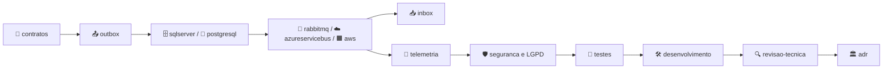

[🏠 TEC.Messaging](../README.md) › 📚 Documentação

# 📚 Documentação do TEC.Messaging

> Referência completa dos seis pacotes (`TEC.Messaging`, `TEC.Messaging.SqlServer`, `TEC.Messaging.PostgreSql`, `TEC.Messaging.RabbitMQ`, `TEC.Messaging.AzureServiceBus` e `TEC.Messaging.Aws`), um arquivo por tema: o README dá a visão geral; aqui ficam os detalhes, conferidos com o código.

## 📑 Sumário

- [🗂️ Temas](#️-temas)
- [🗺️ Mapa dos temas](#️-mapa-dos-temas)
- [📐 Convenções desta documentação](#-convenções-desta-documentação)

---

## 🗂️ Temas

| # | Arquivo | O que responde | Principais tipos |
|:-:|---|---|---|
| 1 | [📜 Contratos de integração](contratos-de-integracao.md) | Como nomear, versionar e mapear eventos; o envelope e o registro com AOT | `[IntegrationEvent]`, `IMessageTypeRegistry`, `IIntegrationEventMapper`, `MessagingBuilder`, `MessageEnvelope` |
| 2 | [📤 Outbox](outbox.md) | Como o evento é gravado e publicado sem perda; falhas, `Dead` e administração | `IOutboxStore`, `OutboxOptions`, `IOutboxAdministration`, `IOutbox`, `TecMessagingSaveChangesInterceptor` |
| 3 | [📥 Inbox](inbox.md) | Como processar cada mensagem uma única vez | `IInboxStore`, `InboxOptions` |
| 4 | [🗄️ SQL Server](sqlserver.md) | Persistência com SQL Server: esquema, índices, reserva (`UPDLOCK`, `READPAST`) e interceptor | `UseSqlServer`, `AddTecMessaging` (modelo), `IDomainEventsSavingObserver`, `UseTecMessaging` |
| 5 | [🐘 PostgreSQL](postgresql.md) | Persistência com PostgreSQL: esquema, índices, reserva (`SKIP LOCKED`, `RETURNING`) | `UsePostgreSql`, `AddTecMessagingPostgreSql`, `TecMessagingPostgreSqlSaveChangesInterceptor`, `UseTecMessagingPostgreSql` |
| 6 | [🐇 RabbitMQ](rabbitmq.md) | Topologia, consumidores, retry, DLQ, concorrência, pausa e circuit breaker | `RabbitMqOptions`, `RabbitMqConsumer`, `QueueDefinition`, `ConsumeResult`, `IDeadLetterAdministration` |
| 7 | [☁️ Azure Service Bus](azureservicebus.md) | Publicação e consumo em tópicos e filas no Azure | `AzureServiceBusOptions`, `AzureServiceBusConsumer`, `ServiceBusConsumerDefinition`, `UseAzureServiceBus` |
| 8 | [🟧 AWS SQS / SNS](aws.md) | Publicação e consumo com Amazon SQS e SNS | `AwsMessagingOptions`, `AwsSqsConsumer`, `SqsConsumerDefinition`, `UseAws` |
| 9 | [📡 Telemetria](telemetria.md) | Spans, métricas, logs e correlação | `MessagingDiagnostics`, `MessageContext` |
| 10 | [🛡️ Segurança e LGPD](seguranca.md) | Sanitização de PII, segredos, limites, riscos residuais e checklist | `SensitiveDataSanitizer` (interno), `MessagingOptions` |
| 11 | [🧪 Testes](testes.md) | Categorias, integração local, carga e benchmarks | — |
| 12 | [🛠️ Desenvolvimento](desenvolvimento.md) | Build, modo local, lock files, arquivos canônicos e publicação | — |
| 13 | [🔍 Revisão técnica](revisao-tecnica.md) | Achados de segurança, bugs e organização (2026-10-19), correções aplicadas e melhorias sugeridas | — |
| 14 | [🏛️ Decisões Arquiteturais (ADRs)](adr/README.md) | Registros formais das decisões de arquitetura e engenharia do TEC.Messaging | — |

Fora de `docs/`: [🧰 Samples](../samples/README.md) · [⚙️ CI/CD](../.github/workflows/README.md) · [📝 Changelog](../CHANGELOG.md) · READMEs dos pacotes ([SqlServer](../TEC.Messaging.SqlServer/README.md), [PostgreSql](../TEC.Messaging.PostgreSql/README.md), [RabbitMQ](../TEC.Messaging.RabbitMQ/README.md), [AzureServiceBus](../TEC.Messaging.AzureServiceBus/README.md), [Aws](../TEC.Messaging.Aws/README.md); o do núcleo é o [README da raiz](../README.md)).

### 🏛️ ADRs

| ADR | Decisão |
|:-:|---|
| [0001](adr/0001-outbox-transacional-com-publicacao-fora-da-transacao.md) | Outbox transacional com publicação fora da transação |
| [0002](adr/0002-reserva-concorrente-do-outbox-com-token-e-relogio-do-banco.md) | Reserva concorrente do Outbox com token e relógio do banco |
| [0003](adr/0003-falhas-isoladas-backoff-e-transporte-indisponivel-sem-contar-tentativa.md) | Falhas isoladas, backoff e transporte indisponível sem contar tentativa |
| [0004](adr/0004-inbox-idempotente-na-mesma-transacao-do-efeito.md) | Inbox idempotente na mesma transação do efeito |
| [0005](adr/0005-contratos-de-integracao-versionados-separados-do-dominio.md) | Contratos de integração versionados e separados do domínio |
| [0006](adr/0006-sanitizacao-de-pii-e-credenciais-em-erros-logs-e-cabecalhos.md) | Sanitização de PII e credenciais em erros, logs e cabeçalhos |
| [0007](adr/0007-retry-escalonado-e-dlq-no-rabbitmq-com-filas-de-espera.md) | Retry escalonado e DLQ no RabbitMQ com filas de espera |
| [0008](adr/0008-nucleo-agnostico-com-bancos-e-brokers-em-pacotes-satelites.md) | Núcleo agnóstico com bancos e brokers em pacotes satélites |

---

## 🗺️ Mapa dos temas

---

## 📐 Convenções desta documentação

| Convenção | Significado |
|---|---|
| Fonte da verdade | O código atual: nomes, assinaturas, padrões e mensagens foram conferidos nele |
| Estrutura | Cada tema tem breadcrumb, 📑 Sumário, 🎯 Visão geral, 🚀 Uso, ⚙️ Opções, ❌ Erros, 🛡️ Segurança, ❓ Perguntas frequentes e rodapé de navegação |
| Placeholders | Valores entre `< >` (`<usuario>`, `<senha>`, `<PAT>`) são do seu ambiente; nenhum recurso real é citado |
| Nomes de segredo | Os padrões são `rabbitmq`, `azure-servicebus` e `aws-messaging` no TEC.Vault; todos configuráveis em `ConnectionSecretName` |
| Configuração inválida | Falha na **subida** com `OptionsValidationException` (opções) ou `InvalidOperationException` (registro de contratos) |
| `CancellationToken` | Omitido das tabelas quando é o último parâmetro |
| Alertas | `[!NOTE]` comportamento · `[!TIP]` boa prática · `[!IMPORTANT]` requisito · `[!WARNING]` armadilha · `[!CAUTION]` risco de segurança ou perda de dados |

---
[🏠 README](../README.md) · [📜 Contratos de integração](contratos-de-integracao.md) ➡️
