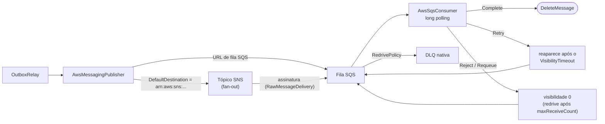

[🏠 TEC.Messaging](../README.md) › [📚 Documentação](README.md) › 🟧 AWS SQS / SNS

# 🟧 AWS SQS e SNS

> Publicação em tópicos SNS ou filas SQS e consumo com long polling, usando o AWS SDK oficial e credenciais do TEC.Vault (ou o papel IAM do ambiente).

## 📑 Sumário

- [🎯 Visão geral](#-visão-geral)
- [🚀 Uso](#-uso)
- [🧩 Formato da mensagem](#-formato-da-mensagem)
- [⚙️ Opções](#️-opções)
- [🛡️ Concorrência e DLQ](#️-concorrência-e-dlq)
- [❌ Erros](#-erros)
- [🛡️ Segurança](#️-segurança)
- [❓ Perguntas frequentes](#-perguntas-frequentes)

---

## 🎯 Visão geral

O pacote `TEC.Messaging.Aws` (AWSSDK.SQS e AWSSDK.SimpleNotificationService 3.7) conecta o ecossistema TEC à nuvem Amazon Web Services:



| Recurso | Detalhes |
|---|---|
| Publicação | Para tópico SNS (`arn:aws:sns:...`) ou para fila SQS (URL), conforme o destino |
| Long polling SQS | `WaitTimeSeconds = 20` por padrão, para minimizar requisições vazias e custo |
| `ConcurrencyLimit` | Processamento paralelo com `SemaphoreSlim` (padrão 5) |
| Dead-Letter Queue | A DLQ é a **nativa do SQS** (`RedrivePolicy` da fila); o pacote não move mensagens para outra fila |
| Credenciais | Segredo `aws-messaging` do TEC.Vault (`ACCESS_KEY_ID:SECRET_ACCESS_KEY`) ou a cadeia padrão da AWS (variáveis, perfil, papel IAM de ECS/EKS/EC2) |
| Health check | `AddTecAws()` |

O pacote **não cria** tópicos, filas nem assinaturas, e não é compatível com Native AOT (`IsAotCompatible=false`).

---

## 🚀 Uso

### 1. Registro dos serviços

```csharp
services.AddTecVault(...); // opcional: segredo "aws-messaging" = ACCESS_KEY_ID:SECRET_ACCESS_KEY

services.AddTecMessaging()
    .UseAws(o =>
    {
        o.Region = "sa-east-1";
        o.DefaultDestination = "arn:aws:sns:sa-east-1:123456789012:vendas-eventos";
    }, builder.Configuration.GetSection(AwsMessagingOptions.SectionName))
    .AddAwsSqsConsumer<EnvioNotaFiscalConsumer>()
    .AddOutboxRelay();

services.AddHealthChecks().AddTecAws();
```

`UseAws(configure, configuration)`: a seção de configuração (`Messaging:Aws`) é aplicada primeiro e o código depois. `AddAwsSqsConsumer<T>()` registra o consumidor como singleton e como serviço em segundo plano. `AddTecAws(name = "aws-messaging", tags = ["ready"])`.

> [!IMPORTANT]
> `DefaultDestination` é, na prática, obrigatório para publicar: se ficar vazio, o destino é o `Type` do contrato (`vendas.pedido-aprovado`), que não é um ARN nem uma URL de fila, e a publicação falha. Todas as mensagens do serviço vão para o **mesmo** destino; o consumidor distingue pelo tipo (atributo `type`).

### 2. Consumidor

```csharp
public sealed class EnvioNotaFiscalConsumer(
    AwsSqsConsumerDependencies deps,
    IServiceScopeFactory scopes)
    : AwsSqsConsumer(deps)
{
    protected override SqsConsumerDefinition Definition { get; } = new(
        QueueUrl: "https://sqs.sa-east-1.amazonaws.com/123456789012/vendas-notafiscal",
        MaxNumberOfMessages: 10,
        WaitTimeSeconds: 20,
        VisibilityTimeoutSeconds: 30,
        ConcurrencyLimit: 8);

    protected override async Task<ConsumeResult> HandleAsync(ReceivedMessage message, CancellationToken ct)
    {
        await using var scope = scopes.CreateAsyncScope();
        var inbox = scope.ServiceProvider.GetRequiredService<IInboxStore>();

        if (!await inbox.TryBeginAsync(message.Envelope.MessageId, "envio-nf", ct))
            return ConsumeResult.Completed;

        // Processar emissão...
        return ConsumeResult.Completed;
    }
}
```

`SqsConsumerDefinition(QueueUrl, MaxNumberOfMessages = 10, WaitTimeSeconds = 20, VisibilityTimeoutSeconds = 30, ConcurrencyLimit = 5)`. Os valores vão direto para o `ReceiveMessage` do SQS (que impõe os próprios limites); o pacote não os valida.

---

## 🧩 Formato da mensagem

O corpo é o **payload** JSON; o resto do envelope viaja em atributos de mensagem (SNS `MessageAttributes` ou SQS `MessageAttributes`):

| Campo do envelope | Atributo | Tipo |
|---|---|---|
| `MessageId` | `messageId` | String |
| `Type` | `type` | String |
| `Version` | `version` | Number |
| `OccurredAt` | `occurredAt` (ISO 8601) | String |
| `CorrelationId` | `correlationId` | String (se houver) |
| `CausationId` | `causationId` | String (se houver) |
| `TraceParent` | `traceparent` (o id do span de publicação) | String (se houver) |

No consumo o envelope é remontado a partir dos atributos: `messageId` (ou o `MessageId` do SQS, se for um GUID; senão um novo `Guid`), `type` (`unknown` se ausente), `version` (1 se ausente), correlação, causa e `traceparent`. `OccurredAt` recebe a hora do **recebimento** (o atributo `occurredAt` não é lido). `ReceivedMessage.PreviousFailures` = `ApproximateReceiveCount - 1`.

> [!IMPORTANT]
> Para o consumidor ler os atributos, a mensagem precisa chegar à fila SQS com os atributos de mensagem intactos. Ao ligar um tópico SNS a uma fila SQS, ative a entrega bruta (*raw message delivery*) na assinatura; sem ela o SNS embrulha tudo num JSON e o consumidor não encontra `messageId` nem `type`.

---

## ⚙️ Opções

| Opção (`AwsMessagingOptions`, seção `Messaging:Aws`) | Padrão | Descrição |
|---|---|---|
| `Enabled` | `true` | Desliga o transporte: a publicação lança `InvalidOperationException`; o health check responde `Healthy` |
| `ConnectionSecretName` | `aws-messaging` | Segredo do TEC.Vault com `ACCESS_KEY_ID:SECRET_ACCESS_KEY`; obrigatório como nome, mas o segredo pode não existir (ver abaixo) |
| `Region` | `us-east-1` | Região AWS (ex.: `sa-east-1`) |
| `DefaultDestination` | `""` | ARN do tópico SNS ou URL da fila SQS para publicação |
| `PublishTimeout` | 10 s | Tempo limite da publicação (1 s a 5 min) |

Opções inválidas falham na subida (`OptionsValidationException`).

**Credenciais.** Na primeira necessidade o pacote lê o segredo `ConnectionSecretName`: se existir e tiver o formato `ACCESS_KEY_ID:SECRET_ACCESS_KEY` (separados por `:`), usa essas chaves; se o segredo não existir, estiver vazio ou não tiver `:`, usa a cadeia padrão da AWS (variáveis de ambiente, perfil, papel IAM da tarefa/pod/instância). Sessões temporárias (token de sessão) só pela cadeia padrão. O mesmo par de clientes (SQS e SNS) é reutilizado.

---

## 🛡️ Concorrência e DLQ

O consumidor faz *long polling* (`ReceiveMessage` com `MaxNumberOfMessages` e `WaitTimeSeconds`) e despacha cada mensagem para execução paralela controlada por um `SemaphoreSlim(ConcurrencyLimit)`. O handler recebe o `CancellationToken` de parada do host.

| `ConsumeResult` | Operação no SQS | Efeito |
|---|---|---|
| `Completed` | `DeleteMessage` | Remove a mensagem da fila |
| `Retry(motivo)` · exceção no handler | (nenhuma) | A mensagem reaparece depois do `VisibilityTimeoutSeconds` e conta uma recepção |
| `Reject(motivo)` | `ChangeMessageVisibility(0)` | Volta a ficar visível na hora; vai para a DLQ quando atingir o `maxReceiveCount` da `RedrivePolicy` da fila |
| `Requeue(motivo)` | `ChangeMessageVisibility(0)` | Volta a ficar visível na hora (conta uma recepção) |

- A DLQ é configurada **na fila SQS** (`RedrivePolicy` com `deadLetterTargetArn` e `maxReceiveCount`): sem ela, a mensagem rejeitada reaparece indefinidamente.
- Nenhum motivo é gravado na mensagem: ao contrário do RabbitMQ e do Azure Service Bus, o SQS não guarda o motivo da rejeição. Ele só aparece no que o handler registrar em log.
- Falha no laço de recebimento (rede, credencial): erro registrado e nova tentativa em 2 s.
- Não há `Pause`/`Resume`, administração da DLQ pelo pacote nem espera escalonada entre tentativas (use o `VisibilityTimeoutSeconds` e a `RedrivePolicy`).

---

## ❌ Erros

| Situação | Causa | O que fazer |
|---|---|---|
| Publicação falha com `InvalidOperationException: Transporte AWS desabilitado.` | `Enabled = false` | Habilite, ou aceite que o Outbox conte tentativas (ver abaixo) |
| Publicação falha com `AmazonSQSException`/`AmazonSimpleNotificationServiceException` | Destino inexistente ou vazio (`DefaultDestination`), permissão insuficiente, região errada | Confira o ARN/URL, a região e a política IAM (`sns:Publish` / `sqs:SendMessage`) |
| Mensagens consumidas com `type` = `unknown` | Assinatura SNS sem entrega bruta ou produtor externo sem os atributos | Ative *raw message delivery* na assinatura |
| Mensagem reaparece sem parar | Sem `RedrivePolicy` na fila, ou handler sempre falha | Configure a DLQ no SQS |
| Health check `Unhealthy` ("Cliente SQS não inicializado" ou "AWS SQS indisponível") | Falha ao criar o cliente (segredo ou credenciais) | Verifique segredo, perfil/papel e região |

> [!WARNING]
> As exceções de publicação deste pacote **não** implementam `ITransportUnavailableException` (só as do RabbitMQ têm essa marca). Com a AWS fora do ar ou `Enabled = false`, as falhas do Outbox contam tentativa e, esgotado `MaxAttempts`, as mensagens viram `Dead` (recuperáveis com `RequeueAsync`). Veja [📤 Outbox](outbox.md#-visão-geral).

> [!NOTE]
> O health check verifica que os clientes foram criados (credenciais resolvidas); não faz uma chamada à AWS.

## 🛡️ Segurança

> [!WARNING]
> Prefira o papel IAM do ambiente (ECS, EKS, EC2) a chaves de longa duração. Se usar o segredo `aws-messaging`, ele vem só do cofre e nunca é registrado em log; conceda à identidade só as ações necessárias (`sns:Publish` e/ou `sqs:SendMessage` no publicador; `sqs:ReceiveMessage`, `sqs:DeleteMessage` e `sqs:ChangeMessageVisibility` no consumidor).

- O consumidor deste pacote não aplica `MaxPayloadLength` nem valida o envelope recebido: o tamanho é o limite do próprio SQS.
- Exceções do handler viram `Retry` (com o motivo sanitizado) e **não** são registradas em log pelo pacote: registre o erro dentro do handler. O corpo da mensagem nunca é registrado.

## ❓ Perguntas frequentes

<details>
<summary><b>Posso publicar direto em uma fila SQS, sem SNS?</b></summary>

Sim: coloque a URL da fila em `DefaultDestination`. Qualquer destino que não comece com `arn:aws:sns:` é tratado como URL de fila SQS.
</details>

<details>
<summary><b>O Inbox continua necessário?</b></summary>

Sim. O SQS padrão entrega "pelo menos uma vez" e sem ordem garantida: use o [📥 Inbox](inbox.md) para processar uma única vez.
</details>

---
⬅️ [☁️ Azure Service Bus](azureservicebus.md) · [📚 Índice](README.md) · [📡 Telemetria](telemetria.md) ➡️
