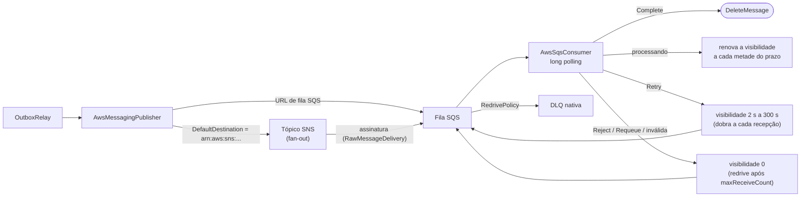

[🏠 TEC.Messaging](../README.md) › [📚 Documentação](README.md) › 🟧 AWS SQS / SNS

# 🟧 AWS SQS e SNS

> Publicação em tópicos SNS ou filas SQS e consumo com long polling, usando o AWS SDK oficial e credenciais do TEC.Vault (ou o papel IAM do ambiente).

## 📑 Sumário

- [🎯 Visão geral](#-visão-geral)
- [🚀 Uso](#-uso)
- [🧩 Formato da mensagem](#-formato-da-mensagem)
- [⚙️ Opções](#️-opções)
- [🛡️ Concorrência e DLQ](#️-concorrência-e-dlq)
- [❌ Erros](#-erros)
- [🛡️ Segurança](#️-segurança)
- [❓ Perguntas frequentes](#-perguntas-frequentes)

---

## 🎯 Visão geral

O pacote `TEC.Messaging.Aws` (AWSSDK.SQS e AWSSDK.SimpleNotificationService 3.7) conecta o ecossistema TEC à nuvem Amazon Web Services:



| Recurso | Detalhes |
|---|---|
| Publicação | Para tópico SNS (`arn:aws:sns:...`) ou para fila SQS (URL), conforme o destino. Só falha transitória (5xx, *throttling*, rede, tempo esgotado) conta como transporte indisponível |
| Long polling SQS | `WaitTimeSeconds = 20` por padrão, para minimizar requisições vazias e custo |
| `ConcurrencyLimit` | Processamento paralelo com `SemaphoreSlim` (padrão 5) |
| Consumo | Envelope validado, `MaxPayloadLength` aplicado, visibilidade renovada enquanto o handler roda e as mesmas métricas de consumo do RabbitMQ |
| Dead-Letter Queue | A DLQ é a **nativa do SQS** (`RedrivePolicy` da fila); o pacote não move mensagens para outra fila |
| Credenciais | Segredo `aws-messaging` do TEC.Vault (`ACCESS_KEY_ID:SECRET_ACCESS_KEY` ou `ACCESS_KEY_ID:SECRET_ACCESS_KEY:SESSION_TOKEN`) ou, com `UseAmbientCredentials = true`, a cadeia padrão da AWS (variáveis, perfil, papel IAM de ECS/EKS/EC2). Credencial recusada recria os clientes relendo o segredo |
| Health check | `AddTecAws()`: lê um atributo do destino padrão na AWS (toca a rede), até 5 s |

O pacote **não cria** tópicos, filas nem assinaturas, e não é compatível com Native AOT (`IsAotCompatible=false`).

---

## 🚀 Uso

### 1. Registro dos serviços

```csharp
services.AddTecVault(...); // obrigatório, mesmo com UseAmbientCredentials; o segredo "aws-messaging" = ACCESS_KEY_ID:SECRET_ACCESS_KEY

services.AddTecMessaging()
    .UseAws(o =>
    {
        o.Region = "sa-east-1";
        o.DefaultDestination = "arn:aws:sns:sa-east-1:123456789012:vendas-eventos";
    }, builder.Configuration.GetSection(AwsMessagingOptions.SectionName))
    .AddAwsSqsConsumer<EnvioNotaFiscalConsumer>()
    .AddOutboxRelay();

services.AddHealthChecks().AddTecAws();
```

`UseAws(configure, configuration)`: a seção de configuração (`Messaging:Aws`) é aplicada primeiro e o código depois. `AddAwsSqsConsumer<T>()` registra o consumidor como singleton e como serviço em segundo plano; chamar de novo com o mesmo tipo não sobe um segundo laço de recebimento. `AddTecAws(name = "aws-messaging", tags = ["ready"])`.

> [!IMPORTANT]
> `DefaultDestination` é obrigatório com o transporte habilitado e é validado na subida: vazio, fora do formato (ARN `arn:aws:sns:região:conta:tópico` ou URL de fila) ou com `http://` exigindo TLS, a aplicação não sobe (`OptionsValidationException`). Todas as mensagens do serviço vão para o **mesmo** destino; o consumidor distingue pelo tipo (atributo `type`).

### 2. Consumidor

```csharp
public sealed class EnvioNotaFiscalConsumer(
    AwsSqsConsumerDependencies deps,
    IServiceScopeFactory scopes)
    : AwsSqsConsumer(deps)
{
    protected override SqsConsumerDefinition Definition { get; } = new(
        QueueUrl: "https://sqs.sa-east-1.amazonaws.com/123456789012/vendas-notafiscal",
        MaxNumberOfMessages: 10,
        WaitTimeSeconds: 20,
        VisibilityTimeoutSeconds: 30,
        ConcurrencyLimit: 8);

    protected override async Task<ConsumeResult> HandleAsync(ReceivedMessage message, CancellationToken ct)
    {
        await using var scope = scopes.CreateAsyncScope();
        var inbox = scope.ServiceProvider.GetRequiredService<IInboxStore>();

        if (!await inbox.TryBeginAsync(message.Envelope.MessageId, "envio-nf", ct))
            return ConsumeResult.Completed;

        // Processar emissão...
        return ConsumeResult.Completed;
    }
}
```

`SqsConsumerDefinition(QueueUrl, MaxNumberOfMessages = 10, WaitTimeSeconds = 20, VisibilityTimeoutSeconds = 30, ConcurrencyLimit = 5)`. A definição é validada na subida do consumidor (URL de fila, `http://` só sem exigência de TLS, `MaxNumberOfMessages` 1 a 10, `WaitTimeSeconds` 0 a 20, `VisibilityTimeoutSeconds` 1 a 43200, `ConcurrencyLimit` 1 ou mais); valor inválido derruba o serviço com `InvalidOperationException`.

---

## 🧩 Formato da mensagem

O corpo é o **payload** JSON; o resto do envelope viaja em atributos de mensagem (SNS `MessageAttributes` ou SQS `MessageAttributes`):

| Campo do envelope | Atributo | Tipo |
|---|---|---|
| `MessageId` | `messageId` | String |
| `Type` | `type` | String |
| `Version` | `version` | Number |
| `OccurredAt` | `occurredAt` (ISO 8601, sempre em UTC) | String |
| `CorrelationId` | `correlationId` | String (se houver) |
| `CausationId` | `causationId` | String (se houver) |
| `TraceParent` | `traceparent` (o id do span de publicação) | String (se houver) |

No consumo o envelope é remontado a partir dos atributos: `messageId` (ou o `MessageId` do SQS; se o valor não for um GUID, um GUID derivado dele por SHA-256, sempre o mesmo para o mesmo texto), `type`, `version` (1 se ausente), correlação, causa e `traceparent`. `OccurredAt` vem do atributo `occurredAt`; sem ele, de `ApproximateFirstReceiveTimestamp` e, sem este, da hora atual. Números e datas são lidos com `CultureInfo.InvariantCulture` e o instante sai em UTC. `ReceivedMessage.PreviousFailures` = `ApproximateReceiveCount - 1`.

O envelope passa por `MessageEnvelope.Validate(MaxPayloadLength)`. Sem `messageId` (ou com `Guid.Empty`), sem `type`, com identificadores acima dos limites ou com corpo acima de `MessagingOptions.MaxPayloadLength`, a mensagem não chega ao handler e é tratada como `Reject`.

> [!IMPORTANT]
> Para o consumidor ler os atributos, a mensagem precisa chegar à fila SQS com os atributos de mensagem intactos. Ao ligar um tópico SNS a uma fila SQS, ative a entrega bruta (*raw message delivery*) na assinatura; sem ela o SNS embrulha tudo num JSON e o consumidor não encontra `messageId` nem `type`.

---

## ⚙️ Opções

| Opção (`AwsMessagingOptions`, seção `Messaging:Aws`) | Padrão | Descrição |
|---|---|---|
| `Enabled` | `true` | Desliga o transporte na publicação: ela lança `AwsMessagingUnavailableException` e o Outbox retém as mensagens sem contar tentativa; o health check responde `Healthy`. O consumidor ignora esta opção |
| `UseAmbientCredentials` | `false` | Permite a cadeia padrão de credenciais da AWS quando o segredo do cofre não existe, está vazio ou não tem o formato `chave:segredo[:token]` |
| `ConnectionSecretName` | `aws-messaging` | Segredo do TEC.Vault com `ACCESS_KEY_ID:SECRET_ACCESS_KEY`; obrigatório como nome, mas o segredo pode não existir com `UseAmbientCredentials = true` (ver abaixo) |
| `Region` | `us-east-1` | Região AWS (ex.: `sa-east-1`) |
| `DefaultDestination` | `""` | ARN do tópico SNS ou URL da fila SQS para publicação; obrigatório com `Enabled = true` |
| `PublishTimeout` | 10 s | Tempo limite da publicação (1 s a 5 min) |
| `RequireTls` | `null` | `null` = exige TLS fora de Development. Exigindo, URL `http://` em `DefaultDestination` ou na definição de um consumidor é recusada na subida. Os clientes nunca usam HTTP (`UseHttp = false`) |

Opções inválidas falham na subida (`OptionsValidationException`).

**Credenciais.** Na primeira necessidade o pacote lê o segredo `ConnectionSecretName`: se existir e tiver o formato `ACCESS_KEY_ID:SECRET_ACCESS_KEY` (separados por `:`), usa essas chaves. Se o segredo não existir, estiver vazio ou não tiver `:`, o comportamento depende de `UseAmbientCredentials`: com `true`, usa a cadeia padrão da AWS (variáveis de ambiente, perfil, papel IAM da tarefa/pod/instância); com `false` (padrão), lança `InvalidOperationException`. Credenciais temporárias do STS entram como `ACCESS_KEY_ID:SECRET_ACCESS_KEY:SESSION_TOKEN`. O par de clientes (SQS e SNS) é reutilizado até a AWS recusar a credencial (`InvalidClientTokenId`, `UnrecognizedClientException`, `SignatureDoesNotMatch`, `ExpiredToken` e afins): aí os dois são descartados, uma única vez mesmo com várias falhas simultâneas, e a próxima operação relê o segredo. Rotação de chave ou token vencido não exigem reiniciar. `AccessDenied` (falta de permissão) não dispara a recriação.

> [!WARNING]
> Com `UseAmbientCredentials = true`, uma falha de leitura do cofre faz o pacote trocar em silêncio para a identidade do ambiente, que pode ter outras permissões. Use essa opção só quando a identidade do ambiente for a esperada.

---

## 🛡️ Concorrência e DLQ

O consumidor faz *long polling* (`ReceiveMessage` com `MaxNumberOfMessages` e `WaitTimeSeconds`) e despacha cada mensagem para execução paralela controlada por um `SemaphoreSlim(ConcurrencyLimit)`. O handler recebe o `CancellationToken` de parada do host.

| `ConsumeResult` | Operação no SQS | Efeito |
|---|---|---|
| `Completed` | `DeleteMessage` | Remove a mensagem da fila |
| `Retry(motivo)` · exceção no handler | `ChangeMessageVisibility(2^(n+1) s)` | A mensagem reaparece depois de 2 s, 4 s, 8 s... até 300 s (n = recepções anteriores) e conta uma recepção |
| `Reject(motivo)` · envelope inválido | `ChangeMessageVisibility(0)` | Volta a ficar visível na hora; vai para a DLQ quando atingir o `maxReceiveCount` da `RedrivePolicy` da fila |
| `Requeue(motivo)` | `ChangeMessageVisibility(0)` | Volta a ficar visível na hora (conta uma recepção) |

- A DLQ é configurada **na fila SQS** (`RedrivePolicy` com `deadLetterTargetArn` e `maxReceiveCount`): sem ela, a mensagem rejeitada reaparece indefinidamente.
- Nenhum motivo é gravado na mensagem: ao contrário do RabbitMQ e do Azure Service Bus, o SQS não guarda o motivo da rejeição. Ele só aparece no que o handler registrar em log.
- Falha no laço de recebimento, inclusive ao obter o cliente na subida (cofre fora, rede, credencial): erro sanitizado em log e nova tentativa com espera de 2 s a 60 s. O serviço não cai. Credencial recusada recria os clientes.
- Não há `Pause`/`Resume` nem administração da DLQ pelo pacote. A espera entre tentativas é só a do `Retry` (2 s a 300 s); `Reject` e `Requeue` voltam na hora.
- **Visibilidade renovada.** Enquanto o handler roda, a visibilidade é renovada para `VisibilityTimeoutSeconds` a cada metade desse prazo; um handler mais lento que o prazo não faz a mensagem reaparecer para outro consumidor. A renovação para no limite de 12 h do SQS ou no primeiro erro (com log; a mensagem pode ser entregue de novo). Mensagens que ainda esperam vaga de `ConcurrencyLimit` não são renovadas: mantenha o prazo acima da espera por vaga e use o Inbox.
- No desligamento, o consumidor para de receber e espera até 30 s pelos handlers em andamento. O handler recebe o token de parada do host: cancelado, a mensagem reaparece quando a visibilidade vencer.
- Métricas: `tec.messaging.consumer.messages` e `tec.messaging.consumer.duration`, com `messaging.destination.name` = nome da fila (último segmento da URL, sem a conta) ([📡 Telemetria](telemetria.md)).

---

## ❌ Erros

| Situação | Causa | O que fazer |
|---|---|---|
| Publicação falha com `AwsMessagingUnavailableException: Transporte AWS desabilitado.` | `Enabled = false` | Habilite, ou deixe o Outbox reter as mensagens (não conta tentativa) |
| Publicação falha com `AwsMessagingUnavailableException` (transporte indisponível) | Cofre fora, segredo inválido, HTTP 5xx, *throttling* (429 ou código de limitação), erro de rede ou confirmação fora do `PublishTimeout` | Nada a fazer na mensagem: o Outbox a devolve sem contar tentativa e pausa |
| Publicação falha com `AmazonServiceException` (conta tentativa) | Fila ou tópico inexistente, região errada, `AccessDenied`, credencial recusada, mensagem acima de 256 KiB ou com caractere não aceito pelo SQS | Confira o ARN/URL, a região, a política IAM (`sns:Publish` / `sqs:SendMessage`) e o tamanho do evento; depois `RequeueAsync` das mortas |
| `OptionsValidationException` na subida | `DefaultDestination` vazio, fora do formato ou `http://` exigindo TLS | Informe o ARN ou a URL `https://` |
| `InvalidOperationException` na subida do consumidor | `SqsConsumerDefinition` fora das faixas, ARN no lugar da URL ou `http://` exigindo TLS | Corrija a definição |
| Erro 4501 no laço de consumo | Segredo ausente ou fora do formato com `UseAmbientCredentials = false`, rede ou credencial | Crie o segredo ou ative `UseAmbientCredentials`; o laço tenta de novo sozinho |
| Mensagens rejeitadas como inválidas (evento 4503) | Assinatura SNS sem entrega bruta ou produtor externo sem os atributos `messageId` e `type` | Ative *raw message delivery* na assinatura |
| Mensagem reaparece sem parar | Sem `RedrivePolicy` na fila, ou handler sempre falha | Configure a DLQ no SQS |
| Health check `Unhealthy` | Cofre fora, credencial recusada, destino inexistente, sem permissão de leitura do atributo ou sem resposta em 5 s | Verifique segredo, perfil/papel, região e a permissão `sqs:GetQueueAttributes` (ou `sns:GetTopicAttributes`) |

> [!NOTE]
> Só falha transitória vira `AwsMessagingUnavailableException` ([ADR 0003](adr/0003-falhas-isoladas-backoff-e-transporte-indisponivel-sem-contar-tentativa.md)). Mensagem recusada pela AWS ou destino errado contam tentativa e chegam a `Dead` depois de `OutboxOptions.MaxAttempts`. O limite de 256 KiB do SQS é em bytes e inclui os atributos, enquanto `MaxPayloadLength` conta caracteres: reduza `MessagingOptions.MaxPayloadLength` para um valor que caiba. Acompanhe `outbox.dead` e `outbox.publish_failures` ([📡 Telemetria](telemetria.md)).

## 🛡️ Segurança

> [!WARNING]
> Prefira o papel IAM do ambiente (ECS, EKS, EC2) a chaves de longa duração. Se usar o segredo `aws-messaging`, ele vem só do cofre e nunca é registrado em log; conceda à identidade só as ações necessárias (`sns:Publish` e/ou `sqs:SendMessage` no publicador; `sqs:ReceiveMessage`, `sqs:DeleteMessage` e `sqs:ChangeMessageVisibility` no consumidor; `sqs:GetQueueAttributes` ou `sns:GetTopicAttributes` para o health check).

- O consumidor valida o envelope e aplica `MaxPayloadLength` antes do handler.
- `RequireTls` (padrão: exigido fora de Development) recusa URLs `http://`; os clientes do SDK nunca usam HTTP.
- Exceções do handler viram `Retry` com o motivo sanitizado. Erros do laço, da confirmação e da renovação são registrados sanitizados (eventos 4501 a 4509). O corpo da mensagem nunca é registrado.

## ❓ Perguntas frequentes

<details>
<summary><b>Posso publicar direto em uma fila SQS, sem SNS?</b></summary>

Sim: coloque a URL da fila em `DefaultDestination`. Qualquer destino que não comece com `arn:aws:sns:` é tratado como URL de fila SQS.
</details>

<details>
<summary><b>O Inbox continua necessário?</b></summary>

Sim. O SQS padrão entrega "pelo menos uma vez" e sem ordem garantida: use o [📥 Inbox](inbox.md) para processar uma única vez.
</details>

---
⬅️ [☁️ Azure Service Bus](azureservicebus.md) · [📚 Índice](README.md) · [📡 Telemetria](telemetria.md) ➡️
