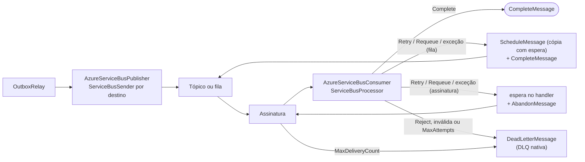

[🏠 TEC.Messaging](../README.md) › [📚 Documentação](README.md) › ☁️ Azure Service Bus

# ☁️ Azure Service Bus

> Publicador e consumidor para filas e tópicos do Azure Service Bus, com a connection string no TEC.Vault e a DLQ nativa do serviço.

## 📑 Sumário

- [🎯 Visão geral](#-visão-geral)
- [🚀 Uso](#-uso)
- [🧩 Formato da mensagem](#-formato-da-mensagem)
- [⚙️ Opções](#️-opções)
- [🛡️ Resiliência e DLQ](#️-resiliência-e-dlq)
- [❌ Erros](#-erros)
- [🛡️ Segurança](#️-segurança)
- [❓ Perguntas frequentes](#-perguntas-frequentes)

---

## 🎯 Visão geral

O pacote `TEC.Messaging.AzureServiceBus` (SDK oficial `Azure.Messaging.ServiceBus` 7.x) conecta a mensageria do ecossistema TEC ao Azure Service Bus:



| Recurso | Detalhes |
|---|---|
| `AzureServiceBusPublisher` (`IMessagePublisher`) | `ServiceBusSender` por destino; o `await` só termina com a confirmação do serviço. Só falha transitória conta como transporte indisponível |
| `AzureServiceBusConsumer` | Base dos consumidores sobre o `ServiceBusProcessor`, com conclusão manual (`AutoCompleteMessages = false`), validação do envelope, `MaxPayloadLength` e métricas de consumo |
| `MaxConcurrentCalls` | Concorrência paralela por consumidor (padrão 10) |
| Nova tentativa | Reenvio agendado com espera crescente (5 s a 15 min) em fila; espera no handler e `Abandon` em assinatura ([ADR 0009](adr/0009-reenvio-agendado-no-azure-service-bus-e-rotacao-de-credenciais.md)) |
| W3C Trace Context | `traceparent`, `CorrelationId` e causa propagados; correlação restaurada no consumidor (`MessageContext`) |
| Dead-Letter Queue | `Reject`, mensagem inválida e `Retry` além de `MaxAttempts` vão à DLQ com motivo e descrição sanitizados; esgotar o `MaxDeliveryCount` da entidade também |
| Health check | `AddTecAzureServiceBus()`: abre o link de envio do `DefaultTopic` (toca a rede), até 5 s |
| Credencial | Connection string no segredo `azure-servicebus` do TEC.Vault, relida quando o serviço recusa a credencial |

O pacote **não cria** tópicos, filas nem assinaturas: eles precisam existir (a política de entregas, TTL e DLQ é da entidade no Azure). Não é compatível com Native AOT (`IsAotCompatible=false`, o SDK usa reflexão no transporte AMQP).

---

## 🚀 Uso

### 1. Registro dos serviços

```csharp
services.AddTecVault(...); // segredo "azure-servicebus" com a connection string do Azure

services.AddTecMessaging()
    .UseAzureServiceBus(o => o.DefaultTopic = "vendas-eventos",
                        builder.Configuration.GetSection(AzureServiceBusOptions.SectionName))
    .AddAzureServiceBusConsumer<FaturamentoConsumer>()
    .AddOutboxRelay();

services.AddHealthChecks().AddTecAzureServiceBus();
```

`UseAzureServiceBus(configure, configuration)`: a seção de configuração (`Messaging:AzureServiceBus`) é aplicada primeiro e o código depois. `AddAzureServiceBusConsumer<T>()` registra o consumidor como singleton e como serviço em segundo plano; chamar de novo com o mesmo tipo não sobe um segundo processador. `AddTecAzureServiceBus(name = "azure-servicebus", tags = ["ready"])`.

> [!IMPORTANT]
> Se `DefaultTopic` ficar vazio, o destino de cada mensagem é o próprio `Type` do contrato (`vendas.pedido-aprovado`): é preciso existir uma entidade com esse nome. Para um tópico único de eventos, informe `DefaultTopic`.

### 2. Consumidor

```csharp
public sealed class FaturamentoConsumer(
    AzureServiceBusConsumerDependencies deps,
    IServiceScopeFactory scopes)
    : AzureServiceBusConsumer(deps)
{
    protected override ServiceBusConsumerDefinition Definition { get; } = new(
        TopicOrQueue: "vendas-eventos",
        Subscription: "faturamento",       // null = fila (TopicOrQueue é o nome da fila)
        MaxConcurrentCalls: 10,
        MaxAttempts: 5);

    protected override async Task<ConsumeResult> HandleAsync(ReceivedMessage message, CancellationToken ct)
    {
        await using var scope = scopes.CreateAsyncScope();
        var inbox = scope.ServiceProvider.GetRequiredService<IInboxStore>();

        if (!await inbox.TryBeginAsync(message.Envelope.MessageId, "faturamento", ct))
            return ConsumeResult.Completed;

        // Processar negócio...
        return ConsumeResult.Completed;
    }
}
```

`ServiceBusConsumerDefinition(TopicOrQueue, Subscription = null, MaxConcurrentCalls = 10, AutoRenewLockDuration = null, MaxAttempts = 5)`. `AutoRenewLockDuration` define o `MaxAutoLockRenewalDuration` do processador (por quanto tempo o SDK renova o lock de um handler demorado). `MaxAttempts` (1 a 100) é quantas falhas a mensagem aguenta antes da DLQ. A definição é validada na subida do consumidor: valor fora da faixa derruba o serviço com `InvalidOperationException`.

---

## 🧩 Formato da mensagem

O corpo é o **payload** JSON (UTF-8, `application/json`); o resto do envelope viaja nas propriedades:

| Campo do envelope | Propriedade do `ServiceBusMessage` |
|---|---|
| `MessageId` | `MessageId` |
| `Type` | `Subject` e `ApplicationProperties["type"]` |
| `Version` | `ApplicationProperties["version"]` |
| `OccurredAt` | `ApplicationProperties["occurred-at"]` (ISO 8601, sempre em UTC) |
| `CorrelationId` | `CorrelationId` |
| `CausationId` | `ApplicationProperties["causation-id"]` |
| `TraceParent` | `ApplicationProperties["traceparent"]` (o id do span de publicação) |

No consumo, o envelope é remontado: `MessageId` (a propriedade `tec-message-id`, presente nas cópias agendadas, ou o id da mensagem; se não for um GUID, um GUID derivado dele por SHA-256, sempre o mesmo para o mesmo texto), `Type` do `Subject` (ou da propriedade `type`), `Version` da propriedade (1 se ausente), `OccurredAt` da propriedade `occurred-at` (ou `occurredAt`; sem nenhuma delas, o `EnqueuedTime`), correlação e causa. Números e datas são lidos com `CultureInfo.InvariantCulture` e o instante sai em UTC.

O envelope montado passa por `MessageEnvelope.Validate(MaxPayloadLength)`. Mensagem sem `MessageId` (ou com `Guid.Empty`), sem tipo, com correlação, causa ou `traceparent` acima dos limites, ou com payload acima de `MessagingOptions.MaxPayloadLength` vai direto para a DLQ com o motivo `InvalidMessage`, sem chegar ao handler. O tamanho em bytes é conferido antes de o corpo virar texto.

`ReceivedMessage.PreviousFailures` é o maior entre a propriedade `tec-attempt` (que acompanha a cópia agendada) e `DeliveryCount - 1`; `Redelivered` é verdadeiro quando houve entrega anterior ou falha registrada.

| Propriedade de controle | Quem grava | Conteúdo |
|---|---|---|
| `tec-attempt` | Reenvio agendado e `Abandon` em assinatura | Falhas já consumidas |
| `tec-reschedule` | Reenvio agendado | Quantas cópias já foram agendadas (compõe o `MessageId` da cópia) |
| `tec-message-id` | Reenvio agendado | Id do envelope (a cópia tem `MessageId` próprio, `{id}:{reenvio}`) |
| `tec-error` | Reenvio agendado e `Abandon` | Último motivo, sanitizado e limitado a 1000 caracteres |

---

## ⚙️ Opções

| Opção (`AzureServiceBusOptions`, seção `Messaging:AzureServiceBus`) | Padrão | Descrição |
|---|---|---|
| `Enabled` | `true` | Desliga o transporte na publicação: ela lança `AzureServiceBusUnavailableException` e o Outbox retém as mensagens sem contar tentativa; o health check responde `Healthy`. O consumidor ignora esta opção |
| `ConnectionSecretName` | `azure-servicebus` | Segredo do TEC.Vault com a connection string (obrigatório) |
| `DefaultTopic` | `""` | Tópico (ou fila) padrão de saída; vazio = o `Type` do contrato (e o health check responde `Degraded`, sem testar a rede) |
| `PublishTimeout` | 10 s | Tempo limite da confirmação da publicação (1 s a 5 min) |
| `RequireTls` | `null` | `null` = exige TLS fora de Development. Exigindo, a connection string do emulador local (`UseDevelopmentEmulator=true`, AMQP sem TLS) é recusada ao criar o cliente. Fora do emulador o SDK sempre usa TLS |

Opções inválidas falham na subida (`OptionsValidationException`).

---

## 🛡️ Resiliência e DLQ

| `ConsumeResult` | Operação no Service Bus | Efeito |
|---|---|---|
| `Completed` | `CompleteMessageAsync` | Remove a mensagem da entidade |
| `Retry(motivo)` · exceção no handler (fila) | `ScheduleMessageAsync` de uma cópia + `CompleteMessageAsync` da original | A cópia volta depois de 5 s, 10 s, 20 s... (teto de 15 min), com `tec-attempt` incrementado |
| `Requeue(motivo)` (fila) | Igual ao `Retry`, com a espera inicial (5 s) | Não consome tentativa (`tec-attempt` fica igual) |
| `Retry` · `Requeue` (assinatura) | Espera no handler (lock renovado) + `AbandonMessageAsync` com `tec-attempt` | A espera é limitada a `AutoRenewLockDuration` (padrão 5 min) menos 30 s |
| `Retry` com `MaxAttempts` esgotado · `Reject(motivo)` | `DeadLetterMessageAsync("ProcessingRejected", motivo sanitizado)` | Vai direto para a DLQ da entidade |
| Envelope inválido | `DeadLetterMessageAsync("InvalidMessage", motivo)` | Nem chega ao handler |

- **Reenvio agendado e duplicidade.** Agendar a cópia e concluir a original não são uma operação atômica. O pacote agenda primeiro e conclui depois: se a conclusão falha com o lock perdido, a cópia é cancelada (a original volta sozinha); em qualquer outra falha a cópia fica e a mensagem pode ser processada duas vezes. Duplicidade é preferível a perda, e o [📥 Inbox](inbox.md) resolve a repetição. A cópia leva `MessageId` próprio para não ser descartada pela detecção de duplicatas da fila. O raciocínio completo está no [ADR 0009](adr/0009-reenvio-agendado-no-azure-service-bus-e-rotacao-de-credenciais.md).
- **Assinatura de tópico.** Uma cópia enviada ao tópico chegaria a todas as assinaturas, então a espera acontece dentro do handler e ocupa uma vaga de `MaxConcurrentCalls`. Cada `Abandon` também incrementa o `DeliveryCount`: mantenha o `MaxDeliveryCount` da assinatura acima de `MaxAttempts`, ou o serviço move a mensagem para a DLQ antes. Para espera longa sem ocupar vagas, encaminhe a assinatura para uma fila (`ForwardTo`) e consuma a fila.
- **Credencial recusada.** `UnauthorizedAccessException` no processador derruba o processador, descarta o cliente (uma única vez, mesmo com várias falhas simultâneas) e reabre com o segredo relido do cofre. Falha ao subir o processador espera de 5 s a 60 s antes de tentar de novo.
- Não há `Pause`/`Resume` neste consumidor. O motivo e a descrição enviados à DLQ passam pelo `SensitiveDataSanitizer`. Erros do processador e do handler são registrados sanitizados (eventos 4601 a 4611).
- A administração da DLQ (`IDeadLetterAdministration`) é só do RabbitMQ: no Azure use as ferramentas do próprio serviço (portal ou SDK).
- Métricas: `tec.messaging.consumer.messages` e `tec.messaging.consumer.duration`, com `messaging.destination.name` = fila ou `tópico/assinatura` ([📡 Telemetria](telemetria.md)).

---

## ❌ Erros

| Situação | Causa | O que fazer |
|---|---|---|
| `InvalidOperationException: Segredo 'azure-servicebus' do Azure Service Bus indisponível no cofre (...)` | Segredo ausente ou cofre fora | Crie o segredo com a connection string |
| `AzureServiceBusUnavailableException: Transporte Azure Service Bus desabilitado.` | `Enabled = false` na publicação | Habilite, ou deixe o Outbox reter as mensagens (não conta tentativa) |
| `AzureServiceBusUnavailableException` (conta como transporte indisponível) | Cofre fora, connection string inválida, `ServiceBusy`, `ServiceTimeout`, `ServiceCommunicationProblem`, outra falha marcada como transitória pelo SDK, erro de rede ou confirmação fora do `PublishTimeout` | Nada a fazer na mensagem: o Outbox a devolve sem contar tentativa e pausa |
| `ServiceBusException` (`MessageSizeExceeded`, `MessagingEntityNotFound`, `MessagingEntityDisabled`...) | Mensagem acima do limite da entidade, entidade inexistente ou desabilitada | Conta tentativa; esgotadas, a mensagem vira `Dead`. Corrija e use `RequeueAsync` |
| `UnauthorizedAccessException` | Permissão `Send` ausente, chave rotacionada ou SAS vencida | Conta tentativa e descarta o cliente: a próxima tentativa relê o segredo |
| `InvalidOperationException` mencionando `UseDevelopmentEmulator` | Emulador local com `RequireTls` exigido | Use o namespace real ou `RequireTls = false` |
| Health check `Degraded` | `DefaultTopic` vazio | Informe `DefaultTopic` para o check testar a rede |
| Health check `Unhealthy` | Cofre fora, connection string inválida, credencial recusada, entidade inexistente ou sem resposta em 5 s | Verifique segredo, permissão e rede |

> [!NOTE]
> Só falha transitória vira `AzureServiceBusUnavailableException` ([ADR 0003](adr/0003-falhas-isoladas-backoff-e-transporte-indisponivel-sem-contar-tentativa.md)). Destino errado ou permissão negada por configuração levam as mensagens a `Dead` depois de `OutboxOptions.MaxAttempts`; acompanhe `outbox.dead` e `outbox.publish_failures` ([📡 Telemetria](telemetria.md)).

## 🛡️ Segurança

> [!WARNING]
> A connection string (com a chave de acesso) vem só do cofre e nunca é registrada em log. Use uma política de acesso compartilhado (SAS) com o menor escopo que cada papel exige:
>
> | Papel | Permissões | Por quê |
> |---|---|---|
> | Publicador | `Send` | Envio ao destino |
> | Consumidor de fila | `Listen` e `Send` na fila | `Retry`, `Requeue` e exceção agendam uma cópia na própria fila (`ScheduleMessageAsync`) |
> | Consumidor de assinatura | `Listen` | O reenvio usa abandono com espera, sem enviar |
>
> O health check (`AddTecAzureServiceBus()`) abre um link de envio para `DefaultTopic`, então precisa de `Send` nessa entidade. Sem ele, o check fica `Unhealthy` mesmo com o consumo funcionando.

- O pacote só aceita connection string; não há autenticação por identidade gerenciada nesta versão.
- O corpo e as propriedades vêm de produtor não confiável do ponto de vista do consumidor: o `Type` só escolhe entre contratos registrados e o nome do span de consumo cai para o destino quando o tipo não tem o formato de contrato.
- O consumidor valida o envelope e aplica `MaxPayloadLength` antes do handler; mensagem fora dos limites vai para a DLQ.
- Rotação da chave de acesso não exige reiniciar: quando o serviço recusa a credencial, o cliente é descartado e o segredo é relido do cofre.
- `RequireTls` (padrão: exigido fora de Development) recusa o emulador local, que fala AMQP sem TLS.
- Mensagens das exceções de indisponibilidade passam pelo `SensitiveDataSanitizer`; a connection string nunca aparece nelas, nem quando é inválida.

## ❓ Perguntas frequentes

<details>
<summary><b>Posso usar fila em vez de tópico?</b></summary>

Sim. No consumidor deixe `Subscription` nulo e informe o nome da fila em `TopicOrQueue`; no publicador, `DefaultTopic` pode ser o nome da fila.
</details>

<details>
<summary><b>O Inbox continua necessário?</b></summary>

Sim. O Service Bus entrega "pelo menos uma vez" (lock expirado, `Abandon`, reentrega): use o [📥 Inbox](inbox.md) para processar uma única vez.
</details>

---
⬅️ [🐇 RabbitMQ](rabbitmq.md) · [📚 Índice](README.md) · [🟧 AWS SQS / SNS](aws.md) ➡️
