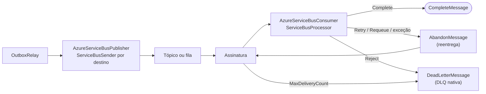

[🏠 TEC.Messaging](../README.md) › [📚 Documentação](README.md) › ☁️ Azure Service Bus

# ☁️ Azure Service Bus

> Publicador e consumidor para filas e tópicos do Azure Service Bus, com a connection string no TEC.Vault e a DLQ nativa do serviço.

## 📑 Sumário

- [🎯 Visão geral](#-visão-geral)
- [🚀 Uso](#-uso)
- [🧩 Formato da mensagem](#-formato-da-mensagem)
- [⚙️ Opções](#️-opções)
- [🛡️ Resiliência e DLQ](#️-resiliência-e-dlq)
- [❌ Erros](#-erros)
- [🛡️ Segurança](#️-segurança)
- [❓ Perguntas frequentes](#-perguntas-frequentes)

---

## 🎯 Visão geral

O pacote `TEC.Messaging.AzureServiceBus` (SDK oficial `Azure.Messaging.ServiceBus` 7.x) conecta a mensageria do ecossistema TEC ao Azure Service Bus:



| Recurso | Detalhes |
|---|---|
| `AzureServiceBusPublisher` (`IMessagePublisher`) | Cache de `ServiceBusSender` por destino; o `await` só termina com a confirmação do serviço |
| `AzureServiceBusConsumer` | Base dos consumidores sobre o `ServiceBusProcessor`, com conclusão manual (`AutoCompleteMessages = false`) |
| `MaxConcurrentCalls` | Concorrência paralela por consumidor (padrão 10) |
| W3C Trace Context | `traceparent`, `CorrelationId` e causa propagados; correlação restaurada no consumidor (`MessageContext`) |
| Dead-Letter Queue | `Reject` envia à DLQ com motivo e descrição sanitizados contra PII; esgotar o `MaxDeliveryCount` da assinatura também |
| Health check | `AddTecAzureServiceBus()` |
| Credencial | Connection string no segredo `azure-servicebus` do TEC.Vault |

O pacote **não cria** tópicos, filas nem assinaturas: eles precisam existir (a política de entregas, TTL e DLQ é da entidade no Azure). Não é compatível com Native AOT (`IsAotCompatible=false`, o SDK usa reflexão no transporte AMQP).

---

## 🚀 Uso

### 1. Registro dos serviços

```csharp
services.AddTecVault(...); // segredo "azure-servicebus" com a connection string do Azure

services.AddTecMessaging()
    .UseAzureServiceBus(o => o.DefaultTopic = "vendas-eventos",
                        builder.Configuration.GetSection(AzureServiceBusOptions.SectionName))
    .AddAzureServiceBusConsumer<FaturamentoConsumer>()
    .AddOutboxRelay();

services.AddHealthChecks().AddTecAzureServiceBus();
```

`UseAzureServiceBus(configure, configuration)`: a seção de configuração (`Messaging:AzureServiceBus`) é aplicada primeiro e o código depois. `AddAzureServiceBusConsumer<T>()` registra o consumidor como singleton e como serviço em segundo plano. `AddTecAzureServiceBus(name = "azure-servicebus", tags = ["ready"])`.

> [!IMPORTANT]
> Se `DefaultTopic` ficar vazio, o destino de cada mensagem é o próprio `Type` do contrato (`vendas.pedido-aprovado`): é preciso existir uma entidade com esse nome. Para um tópico único de eventos, informe `DefaultTopic`.

### 2. Consumidor

```csharp
public sealed class FaturamentoConsumer(
    AzureServiceBusConsumerDependencies deps,
    IServiceScopeFactory scopes)
    : AzureServiceBusConsumer(deps)
{
    protected override ServiceBusConsumerDefinition Definition { get; } = new(
        TopicOrQueue: "vendas-eventos",
        Subscription: "faturamento",       // null = fila (TopicOrQueue é o nome da fila)
        MaxConcurrentCalls: 10);

    protected override async Task<ConsumeResult> HandleAsync(ReceivedMessage message, CancellationToken ct)
    {
        await using var scope = scopes.CreateAsyncScope();
        var inbox = scope.ServiceProvider.GetRequiredService<IInboxStore>();

        if (!await inbox.TryBeginAsync(message.Envelope.MessageId, "faturamento", ct))
            return ConsumeResult.Completed;

        // Processar negócio...
        return ConsumeResult.Completed;
    }
}
```

`ServiceBusConsumerDefinition(TopicOrQueue, Subscription = null, MaxConcurrentCalls = 10, AutoRenewLockDuration = null)`. `AutoRenewLockDuration` define o `MaxAutoLockRenewalDuration` do processador (por quanto tempo o SDK renova o lock de um handler demorado).

---

## 🧩 Formato da mensagem

O corpo é o **payload** JSON (UTF-8, `application/json`); o resto do envelope viaja nas propriedades:

| Campo do envelope | Propriedade do `ServiceBusMessage` |
|---|---|
| `MessageId` | `MessageId` |
| `Type` | `Subject` e `ApplicationProperties["type"]` |
| `Version` | `ApplicationProperties["version"]` |
| `OccurredAt` | `ApplicationProperties["occurred-at"]` (ISO 8601) |
| `CorrelationId` | `CorrelationId` |
| `CausationId` | `ApplicationProperties["causation-id"]` |
| `TraceParent` | `ApplicationProperties["traceparent"]` (o id do span de publicação) |

No consumo, o envelope é remontado: `MessageId` (um novo `Guid` se o id da mensagem não for um GUID), `Type` do `Subject` (ou da propriedade `type`), `Version` da propriedade (1 se ausente), `OccurredAt` = `EnqueuedTime`, correlação e causa. `ReceivedMessage.PreviousFailures` = `DeliveryCount - 1` e `Redelivered` = `DeliveryCount > 1`.

---

## ⚙️ Opções

| Opção (`AzureServiceBusOptions`, seção `Messaging:AzureServiceBus`) | Padrão | Descrição |
|---|---|---|
| `Enabled` | `true` | Desliga o transporte: a publicação lança `InvalidOperationException`; o health check responde `Healthy` |
| `ConnectionSecretName` | `azure-servicebus` | Segredo do TEC.Vault com a connection string (obrigatório) |
| `DefaultTopic` | `""` | Tópico (ou fila) padrão de saída; vazio = o `Type` do contrato |
| `PublishTimeout` | 10 s | Tempo limite da confirmação da publicação (1 s a 5 min) |

Opções inválidas falham na subida (`OptionsValidationException`).

---

## 🛡️ Resiliência e DLQ

| `ConsumeResult` | Operação no Service Bus | Efeito |
|---|---|---|
| `Completed` | `CompleteMessageAsync` | Remove a mensagem da entidade |
| `Retry(motivo)` · `Requeue(motivo)` · exceção no handler | `AbandonMessageAsync` | Libera o lock e a mensagem volta para nova entrega; cada entrega incrementa o `DeliveryCount` |
| `Reject(motivo)` | `DeadLetterMessageAsync("ProcessingRejected", motivo sanitizado)` | Vai direto para a DLQ da entidade |

- A espera entre tentativas **não** é escalonada pelo pacote: depois do `Abandon` a reentrega é imediata. O limite de tentativas é o `MaxDeliveryCount` da assinatura (ou fila) no Azure; ao esgotá-lo o próprio serviço move a mensagem para a DLQ.
- `Retry` e `Requeue` têm o mesmo efeito neste transporte. Não há `Pause`/`Resume` neste consumidor: para uma dependência fora do ar por muito tempo, o `MaxDeliveryCount` da entidade é o único freio.
- O motivo e a descrição enviados à DLQ passam pelo `SensitiveDataSanitizer`. Erros do próprio processador (rede, lock perdido) são registrados em log de erro pelo consumidor; exceções do handler viram `Retry` e **não** são registradas pelo pacote: registre o erro dentro do handler.
- A administração da DLQ (`IDeadLetterAdministration`) é só do RabbitMQ: no Azure use as ferramentas do próprio serviço (portal ou SDK).

---

## ❌ Erros

| Situação | Causa | O que fazer |
|---|---|---|
| `InvalidOperationException: Segredo 'azure-servicebus' do Azure Service Bus indisponível no cofre (...)` | Segredo ausente ou cofre fora | Crie o segredo com a connection string |
| `InvalidOperationException: Transporte Azure Service Bus desabilitado.` | `Enabled = false` na publicação | Habilite, ou aceite que o Outbox conte tentativas (ver abaixo) |
| `ServiceBusException` do SDK | Tópico, fila ou assinatura inexistente, ou permissão insuficiente | Crie a entidade no Azure |
| Health check `Unhealthy` ("Cliente Service Bus fechado" ou "indisponível") | Connection string inválida, rede ou cliente fechado | Verifique segredo e rede |

> [!WARNING]
> As exceções de publicação deste pacote **não** implementam `ITransportUnavailableException` (só as do RabbitMQ têm essa marca). Com o Azure fora do ar ou `Enabled = false`, as falhas do Outbox contam tentativa e, esgotado `MaxAttempts`, as mensagens viram `Dead` (recuperáveis com `RequeueAsync`). Veja [📤 Outbox](outbox.md#-visão-geral).

## 🛡️ Segurança

> [!WARNING]
> A connection string (com a chave de acesso) vem só do cofre e nunca é registrada em log. Use uma política de acesso compartilhado (SAS) com o menor escopo: `Send` para o publicador, `Listen` para o consumidor.

- O pacote só aceita connection string; não há autenticação por identidade gerenciada nesta versão.
- O corpo e as propriedades vêm de produtor não confiável do ponto de vista do consumidor: o `Type` só escolhe entre contratos registrados e o nome do span de consumo cai para o destino quando o tipo não tem o formato de contrato.
- O consumidor deste pacote não aplica `MaxPayloadLength` (o limite de tamanho é o da entidade no Azure).

## ❓ Perguntas frequentes

<details>
<summary><b>Posso usar fila em vez de tópico?</b></summary>

Sim. No consumidor deixe `Subscription` nulo e informe o nome da fila em `TopicOrQueue`; no publicador, `DefaultTopic` pode ser o nome da fila.
</details>

<details>
<summary><b>O Inbox continua necessário?</b></summary>

Sim. O Service Bus entrega "pelo menos uma vez" (lock expirado, `Abandon`, reentrega): use o [📥 Inbox](inbox.md) para processar uma única vez.
</details>

---
⬅️ [🐇 RabbitMQ](rabbitmq.md) · [📚 Índice](README.md) · [🟧 AWS SQS / SNS](aws.md) ➡️
