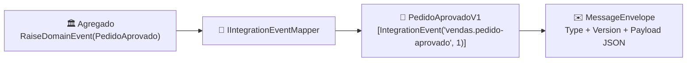

[🏠 TEC.Messaging](../README.md) › [📚 Documentação](README.md) › 📜 Contratos de integração

# 📜 Contratos de integração

> Eventos que saem do serviço têm contrato próprio, com nome e versão estáveis: o domínio pode mudar sem quebrar quem consome.

## 📑 Sumário

- [🎯 Visão geral](#-visão-geral)
- [🚀 Uso](#-uso)
- [📘 O envelope](#-o-envelope)
- [⚙️ Opções](#️-opções)
- [❌ Erros](#-erros)
- [🛡️ Segurança](#️-segurança)
- [❓ Perguntas frequentes](#-perguntas-frequentes)

---

## 🎯 Visão geral



| Conceito | Onde vive | Muda quando |
|---|---|---|
| Evento de domínio (`IDomainEvent`, TEC.Core) | Dentro do serviço | O modelo muda (livremente) |
| Evento de integração (`[IntegrationEvent]`) | Contrato público | Nunca de forma incompatível: crie uma nova versão |

| Peça | Papel |
|---|---|
| `[IntegrationEvent(nome, Version = n)]` | Marca o tipo como contrato, com nome estável e versão (padrão 1) |
| `MessagingBuilder` | `AddEventType<T>()`, `AddEventType<T>(JsonTypeInfo<T>, name?, version?)`, `AddEventTypesFromAssembly`, `AddMapper<T>()`, `Map<TDomainEvent>(...)` |
| `IIntegrationEventMapper` · `IntegrationEventMapper<TDomainEvent>` | Convertem evento de domínio em zero ou mais eventos de integração (sem estado, thread-safe, rápidos: rodam dentro do `SaveChanges`) |
| `IMessageTypeRegistry` · `MessageTypeInfo` | Catálogo imutável nome + versão ↔ tipo CLR, com `Serialize`/`Deserialize` |
| `IntegrationEnvelopeFactory` | Monta o `MessageEnvelope` (id UUIDv7, correlação, causa, `traceparent`, payload) e o valida |

O catálogo é montado uma vez, na primeira resolução de `IMessageTypeRegistry`. Por que contratos separados do domínio: [ADR 0005](adr/0005-contratos-de-integracao-versionados-separados-do-dominio.md).

---

## 🚀 Uso

```csharp
[IntegrationEvent("vendas.pedido-aprovado", Version = 1)]
public sealed record PedidoAprovadoV1(Guid PedidoId, decimal Total);

services.AddTecMessaging()
    .AddEventTypesFromAssembly(typeof(PedidoAprovadoV1).Assembly)     // ou AddEventType<PedidoAprovadoV1>()
    .Map<PedidoAprovado>(e => new PedidoAprovadoV1(e.PedidoId, e.Total))
    .AddMapper<MapeadorDeEstoque>();                                  // mapeador com 0..N eventos
```

`Map<TDomainEvent>` aceita uma função que devolve `null` para "nenhum evento". `AddMapper<T>` registra o mapeador como singleton.

```csharp
internal sealed class MapeadorDeEstoque : IntegrationEventMapper<PedidoAprovado>
{
    protected override IEnumerable<object> Map(PedidoAprovado e)
    {
        foreach (var item in e.Itens)
            yield return new EstoqueReservadoV1(item.ProdutoId, item.Quantidade);
    }
}
```

**Native AOT**: registre com a metadata gerada (sem reflexão). `AddEventType<T>()` e `AddEventTypesFromAssembly` usam reflexão e são marcados com `RequiresUnreferencedCode`/`RequiresDynamicCode`.

```csharp
[JsonSerializable(typeof(PedidoAprovadoV1))]
internal sealed partial class ContratosJson : JsonSerializerContext;

services.AddTecMessaging().AddEventType(ContratosJson.Default.PedidoAprovadoV1);
```

Sem o atributo, informe nome e versão: `AddEventType(ContratosJson.Default.PedidoAprovadoV1, name: "vendas.pedido-aprovado", version: 1)`.

**Consumidor**: desserialize pelo catálogo.

```csharp
if (registry.TryGet(envelope.Type, envelope.Version, out var info) && info.Deserialize(envelope.Payload) is PedidoAprovadoV1 evento) { ... }
```

`TryGet(Type, out info)` faz a busca pelo tipo CLR. Contrato desconhecido devolve `false`: decida entre `ConsumeResult.Reject` (contrato que este serviço nunca vai entender) e ignorar com `Completed`.

### Regras de nome e versão

| Regra | Exemplo |
|---|---|
| Minúsculas, dígitos, `.` e `-`, até 200 caracteres, sem separador nas pontas nem repetido | `vendas.pedido-aprovado` |
| Prefixo do serviço dono | `vendas.pedido-cancelado` |
| Versão 1 ou maior | `Version = 2` |
| Mudança compatível (campo opcional novo) | Mesma versão |
| Mudança incompatível (renomear, remover, mudar tipo) | Novo tipo `...V2` com `Version = 2`; publique as duas até os consumidores migrarem |

Registrar o mesmo tipo duas vezes com o mesmo nome e versão é aceito (idempotente). Nome + versão para dois tipos, ou um tipo com dois nomes, falha ao montar o catálogo.

---

## 📘 O envelope

`MessageEnvelope` é o que o Outbox grava, o broker transporta e o consumidor recebe:

| Campo | Limite | Descrição |
|---|---|---|
| `MessageId` | não vazio | Identificador único (UUIDv7, ordenável pelo tempo); chave da idempotência no consumidor |
| `Type` | até 200 caracteres | Nome estável do contrato |
| `Version` | ≥ 1 | Versão do contrato |
| `OccurredAt` | — | Quando o fato ocorreu (o `OccurredAt` do evento de domínio) |
| `CorrelationId` | até 128 | Correlação do fluxo de negócio (do `MessageContext`) |
| `CausationId` | até 128 | `MessageId` da mensagem consumida que gerou esta |
| `TraceParent` | até 128 | `traceparent` W3C para continuar o trace |
| `Payload` | 1 a `MaxPayloadLength` caracteres | JSON do evento |

`Validate(maxPayloadLength)` devolve falha de validação com os códigos `MENSAGEM_ID_INVALIDO`, `MENSAGEM_TIPO_INVALIDO`, `MENSAGEM_VERSAO_INVALIDA`, `MENSAGEM_CORRELACAO_INVALIDA`, `MENSAGEM_TRACE_INVALIDO` e `MENSAGEM_PAYLOAD_INVALIDO`. A fábrica transforma a falha em `InvalidOperationException`.

O JSON dos contratos registrados por reflexão usa as opções do TEC.Core (`JsonDefaults.Options`: camelCase, enums por nome, nulos omitidos), ou as de `MessagingOptions.JsonSerializerOptions`. Contratos registrados com `JsonTypeInfo` usam as do contexto gerado. O formato no fio de cada broker está nos temas de [🐇 RabbitMQ](rabbitmq.md), [☁️ Azure Service Bus](azureservicebus.md) e [🟧 AWS](aws.md).

---

## ⚙️ Opções

| Opção (`MessagingOptions`, `AddTecMessaging(o => ...)`) | Padrão | Descrição |
|---|---|---|
| `MaxPayloadLength` | 256 KiB | Tamanho máximo do payload em caracteres (1 KiB a 4 MiB), na gravação e no consumo do RabbitMQ |
| `JsonSerializerOptions` | `JsonDefaults.Options` do TEC.Core | JSON dos contratos registrados por reflexão |

Opções inválidas falham na subida. Chamar `AddTecMessaging` de novo é idempotente e devolve um builder sobre os mesmos registros.

## ❌ Erros

| Exceção | Quando ocorre | O que fazer |
|---|---|---|
| `InvalidOperationException` no registro | Nome inválido, versão < 1, tipo sem `[IntegrationEvent]` | Corrija o atributo ou informe nome e versão |
| `InvalidOperationException` ao resolver o catálogo | Mesmo nome+versão para dois tipos, ou um tipo com dois nomes | Um contrato por tipo |
| `InvalidOperationException` no `SaveChanges` | Mapeador devolveu tipo não registrado ou payload grande demais | Registre o contrato; emagreça o evento |
| `ArgumentException` em `MessageTypeInfo.Serialize` | Objeto que não é do tipo do contrato | Passe o evento do tipo registrado |
| `JsonException` em `MessageTypeInfo.Deserialize` | JSON incompatível com o contrato | Rejeite a mensagem (`ConsumeResult.Reject`) |

## 🛡️ Segurança

> [!WARNING]
> Eventos viajam por broker e ficam em DLQs e logs: coloque **ids e metadados**, nunca senhas, tokens ou texto livre com
> dados pessoais. O consumidor que precisar do detalhe consulta o serviço dono.

> [!NOTE]
> A desserialização usa o `JsonTypeInfo` do tipo **registrado** (sem polimorfismo aberto): o `Type` da mensagem só escolhe entre contratos conhecidos.

## ❓ Perguntas frequentes

<details>
<summary><b>Posso publicar o próprio evento de domínio?</b></summary>

Pode (marque-o com `[IntegrationEvent]` e mapeie para ele mesmo), mas perde a proteção: qualquer refatoração do domínio vira
mudança de contrato.
</details>

<details>
<summary><b>Como evoluir um contrato sem quebrar os consumidores?</b></summary>

Campo opcional novo mantém a versão. Mudança incompatível vira um novo tipo com `Version = 2`; o produtor publica as duas versões (dois eventos mapeados do mesmo evento de domínio) até todos os consumidores migrarem.
</details>

---
⬅️ [📚 Índice](README.md) · [📤 Outbox](outbox.md) ➡️
