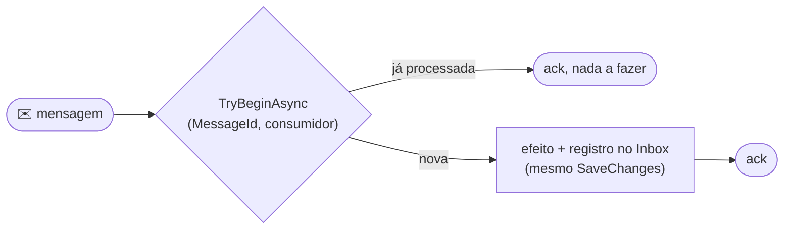

[🏠 TEC.Messaging](../README.md) › [📚 Documentação](README.md) › 📥 Inbox

# 📥 Inbox

> Entrega é "pelo menos uma vez": o Inbox faz o processamento acontecer uma única vez.

## 📑 Sumário

- [🎯 Visão geral](#-visão-geral)
- [🚀 Uso](#-uso)
- [⚙️ Opções](#️-opções)
- [❌ Erros](#-erros)
- [🛡️ Segurança](#️-segurança)
- [❓ Perguntas frequentes](#-perguntas-frequentes)

---

## 🎯 Visão geral



A chave `(MessageId, Consumer)` garante que duas entregas simultâneas não processem duas vezes: uma delas falha no commit
(chave duplicada), volta à fila e, na reentrega, `TryBeginAsync` devolve `false`. Com `IsDuplicate` a própria falha pode ser
reconhecida e encerrada como processada, sem nova tentativa.

| Peça | Papel |
|---|---|
| `IInboxStore.TryBeginAsync(messageId, consumer, ct)` | `false` se a mensagem já foi processada por este consumidor; senão registra na unidade de trabalho atual (gravado no próximo `SaveChanges`) e devolve `true` |
| `IInboxStore.IsDuplicate(exception)` | `true` se a falha do `SaveChanges` é a chave duplicada **do Inbox** (a implementação padrão da interface devolve sempre `false`; SQL Server e PostgreSQL a implementam) |
| `IInboxStore.PurgeAsync(processedBefore, maxRows, ct)` | Apaga registros antigos (usado pela limpeza) |
| `AddInboxCleanup(...)` | Serviço em segundo plano que apaga os registros vencidos |

O Inbox é implementado pelos satélites de banco ([🗄️ SQL Server](sqlserver.md), [🐘 PostgreSQL](postgresql.md)): a tabela `InboxMessages` (`inbox_messages` no PostgreSQL) tem chave primária composta `(MessageId, Consumer)` e `ProcessedAt`. O registro entra no `DbContext` da aplicação e sai no **mesmo** `SaveChanges` do efeito.

Por que o desenho é este está no [ADR 0004](adr/0004-inbox-idempotente-na-mesma-transacao-do-efeito.md).

---

## 🚀 Uso

```csharp
services.AddTecMessaging().UseSqlServer<FinanceiroDbContext>().AddInboxCleanup(o => o.Retention = TimeSpan.FromDays(30));
```

No consumidor (`inbox` e `db` resolvidos no **mesmo escopo**, logo o mesmo `DbContext`):

```csharp
protected override async Task<ConsumeResult> HandleAsync(ReceivedMessage message, CancellationToken ct)
{
    await using var scope = scopes.CreateAsyncScope();
    var inbox = scope.ServiceProvider.GetRequiredService<IInboxStore>();
    var db = scope.ServiceProvider.GetRequiredService<FinanceiroDbContext>();

    if (!await inbox.TryBeginAsync(message.Envelope.MessageId, "faturamento", ct))
        return ConsumeResult.Completed;                       // reentrega: já processada

    db.Faturas.Add(fatura);
    try
    {
        await db.SaveChangesAsync(ct);                        // grava o efeito e o registro do Inbox juntos
    }
    catch (DbUpdateException ex) when (inbox.IsDuplicate(ex))
    {
        return ConsumeResult.Completed;                       // outra entrega simultânea já fez o commit
    }

    return ConsumeResult.Completed;
}
```

Efeitos fora do banco (e-mail, API externa) não entram na transação: use uma chave de idempotência própria no destino, ou
registre cada efeito (ex.: `messageId × destinatário`) antes de executá-lo.

O `TryBeginAsync` aceita o nome do consumidor com até `InboxOptions.MaxConsumerLength` (100) caracteres e lança `ArgumentOutOfRangeException` acima disso (e `ArgumentException` para nome vazio). Em cada fila, use um nome por **consumidor lógico**: duas filas que processam a mesma mensagem com efeitos diferentes precisam de nomes diferentes.

### Quando o consumidor envia outra mensagem

Mensagens gravadas no Outbox durante o processamento herdam a correlação e a causa (o `MessageId` recebido), porque o consumidor abre o `MessageContext` sozinho. O efeito, o registro do Inbox e a nova mensagem do Outbox saem na mesma transação ([📤 Outbox](outbox.md)).

---

## ⚙️ Opções

| Opção (`InboxOptions`, `AddInboxCleanup(o => ...)`) | Padrão | Faixa | Descrição |
|---|---|---|---|
| `Retention` | 30 dias | 1 a 365 dias | Retenção dos registros (maior que o tempo máximo de reentrega, inclusive DLQ reprocessada) |
| `CleanupInterval` | 1 h | 1 min a 1 dia | Intervalo da limpeza |
| `MaxConsumerLength` | 100 | constante | Tamanho máximo do nome do consumidor |

A limpeza apaga em lotes de 5.000 enquanto vierem cheios, por até 1 minuto a cada intervalo, e registra o total (eventos de log 4101 e 4102 para falha). Opções inválidas falham na subida (`OptionsValidationException`).

> [!IMPORTANT]
> `Retention` precisa ser maior que o tempo máximo que uma mensagem pode levar para ser reentregue (filas de espera, DLQ reprocessada, consumidor parado). Uma mensagem reentregue depois da limpeza seria processada de novo.

## ❌ Erros

| Situação | Causa | O que fazer |
|---|---|---|
| `DbUpdateException` (chave duplicada) | Entrega concorrente da mesma mensagem | Normal: trate com `IsDuplicate` ou deixe a mensagem voltar à fila |
| Mensagem processada duas vezes | `SaveChanges` em outro contexto que não o do Inbox | Use o mesmo `DbContext` (mesmo escopo) |
| `ArgumentOutOfRangeException` em `TryBeginAsync` | Nome do consumidor com mais de 100 caracteres | Use um nome curto e estável |
| Tabela `InboxMessages` cresce sem parar | `AddInboxCleanup` não chamado | Registre a limpeza |

## 🛡️ Segurança

> [!NOTE]
> O nome do consumidor é parte da chave: mantenha-o estável. Renomear faz mensagens antigas reentregues serem processadas de novo.

- O `IsDuplicate` só reconhece a chave primária **do Inbox** (no SQL Server, o erro 2627 com o nome da chave; no PostgreSQL, `23505` na constraint da chave). Duplicidade em tabelas da aplicação não vira "já processada".
- O Inbox guarda só ids e o nome do consumidor, nunca o payload.

## ❓ Perguntas frequentes

<details>
<summary><b>Preciso do Inbox se o handler já é idempotente por natureza?</b></summary>

Não. Ex.: "marcar como lido" é idempotente. Use o Inbox quando o efeito acumula (inserir, somar, enviar).
</details>

<details>
<summary><b>O Inbox funciona sem EF Core?</b></summary>

O núcleo só define a interface `IInboxStore`. As implementações do pacote são sobre EF Core (SQL Server e PostgreSQL); outro banco exige uma implementação própria da interface.
</details>

<details>
<summary><b>O que acontece com o registro se o SaveChanges falhar?</b></summary>

Nada é gravado (a mesma transação do efeito). Na reentrega, `TryBeginAsync` devolve `true` de novo e o processamento recomeça.
</details>

---
⬅️ [📤 Outbox](outbox.md) · [📚 Índice](README.md) · [🗄️ SQL Server](sqlserver.md) ➡️
