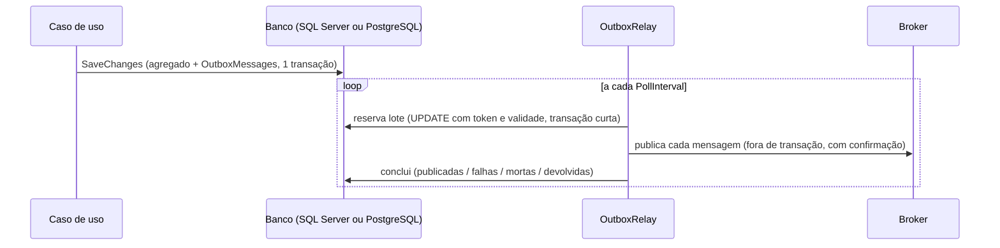

[🏠 TEC.Messaging](../README.md) › [📚 Documentação](README.md) › 📤 Outbox

# 📤 Outbox

> O evento é gravado na mesma transação do agregado e publicado depois, sem perda e sem travar o banco.

## 📑 Sumário

- [🎯 Visão geral](#-visão-geral)
- [🚀 Uso](#-uso)
- [⚙️ Opções](#️-opções)
- [❌ Erros](#-erros)
- [🛡️ Segurança](#️-segurança)
- [❓ Perguntas frequentes](#-perguntas-frequentes)

---

## 🎯 Visão geral



O Outbox tem três peças:

| Peça | Onde | Papel |
|---|---|---|
| `TecMessagingSaveChangesInterceptor` (ou o do PostgreSQL) | [🗄️ SQL Server](sqlserver.md) · [🐘 PostgreSQL](postgresql.md) | Converte os eventos de domínio dos agregados em linhas do Outbox no `SaveChanges` |
| `IOutboxStore` · `IOutboxAdministration` · `IOutbox` | Núcleo (abstrações) + satélite do banco | Reserva, conclusão, limpeza, administração e gravação sem agregado |
| `OutboxRelay` | Núcleo (`AddOutboxRelay`) | Serviço em segundo plano que reserva, publica e conclui. Pode rodar em vários processos |

Situações de uma mensagem (`OutboxMessageStatus`): `Pending` (0, inclusive em espera depois de falha), `Published` (1) e `Dead` (2).

| Desfecho | Efeito |
|---|---|
| Publicada | `Status = Published`, removida depois de `PublishedRetention` |
| Falha | `Attempts + 1`, nova tentativa em `InitialRetryDelay × 2^(n-1)` (teto `MaxRetryDelay`). **As outras mensagens seguem** |
| Esgotou `MaxAttempts` | `Status = Dead`: não volta sozinha; o administrador reprocessa ou descarta |
| Transporte indisponível (exceção com `ITransportUnavailableException`: broker fora, circuito aberto, `Enabled = false` no RabbitMQ, confirmação fora do prazo) | A mensagem, as falhas seguidas que a precederam e o resto do lote voltam **sem contar** tentativa; o relay pausa `PauseDuration`. Indisponibilidade longa não leva a `Dead` |
| `ConsecutiveFailuresToPause` falhas seguidas sem essa marca | As falhas contam tentativa (podem ser mensagens defeituosas); o resto do lote volta sem contar e o relay pausa `PauseDuration` |
| Publicação passa de 80% da reserva (`LeaseDuration`) | Cancelada; a mensagem e o resto do lote voltam sem contar tentativa (outro relay não a publica em dobro) |
| Desligamento do host | O resto do lote volta sem contar tentativa e a conclusão ainda é gravada (prazo de 30 s) |

Ritmo do relay: a cada ciclo ele espera `PollInterval` se o lote veio incompleto, volta na hora se veio cheio (`BatchSize`) e espera `PauseDuration` se pausou ou se o ciclo falhou (erro 4004). A limpeza das publicadas e a atualização das métricas rodam no mesmo laço, nos intervalos `CleanupInterval` e `StatisticsInterval`.

> [!NOTE]
> A ordem é a de ocorrência dentro de um lote, mas **não é garantida** entre lotes, relays e novas tentativas. Consumidores
> devem ser idempotentes ([Inbox](inbox.md)) e tolerar reordenação (ex.: comparar versões/datas).

> [!IMPORTANT]
> Falhas **sem** a marca de transporte indisponível contam tentativa. Se o seu `IMessagePublisher` próprio lança exceções para broker fora do ar, implemente `ITransportUnavailableException` nelas, senão uma queda longa leva as mensagens a `Dead` (as exceções do RabbitMQ já têm a marca; AWS e Azure Service Bus não, ver [☁️](azureservicebus.md) e [🟧](aws.md)).

---

## 🚀 Uso

```csharp
services.AddTecMessaging()
    .AddEventType<PedidoAprovadoV1>()
    .Map<PedidoAprovado>(e => new PedidoAprovadoV1(e.PedidoId, e.Total))
    .UseSqlServer<VendasDbContext>()                  // ou UsePostgreSql<VendasDbContext>()
    .UseRabbitMq(o => o.Exchange = "vendas.eventos")  // ou UseAzureServiceBus / UseAws
    .AddDomainEventsObserver<GravadorDeHistorico>()   // SQL Server, opcional: dados próprios na mesma transação
    .AddOutboxRelay(o => o.MaxAttempts = 15);         // em quantos processos quiser

services.AddDbContext<VendasDbContext>((sp, o) => o.UseSqlServer(conexao).UseTecMessaging(sp));
```

`AddOutboxRelay` exige um `IOutboxStore` (satélite do banco) e um `IMessagePublisher` (satélite do broker). As opções são validadas na subida.

Quando o registro do contexto não expõe as opções (ex.: `AddTecOrm`), ligue o interceptor no próprio contexto:

```csharp
public sealed class VendasDbContext(DbContextOptions<VendasDbContext> options, TecMessagingSaveChangesInterceptor outbox) : DbContext(options)
{
    protected override void OnConfiguring(DbContextOptionsBuilder optionsBuilder) => optionsBuilder.AddInterceptors(outbox);

    protected override void OnModelCreating(ModelBuilder modelBuilder) => modelBuilder.AddTecMessaging("vendas");
}
```

Gere a migration depois de chamar `AddTecMessaging`. O índice das pendentes (`IX_OutboxMessages_Pending`, filtrado em
`Status = 0`, chave `OccurredAt, Id` com `NextAttemptAt`, `LeasedUntil` e `Attempts` incluídos) segue a ordem da reserva: várias
instâncias reservam lotes ao mesmo tempo sem pular mensagens livres. Não troque a ordem das colunas dele. Esquema completo em [🗄️ SQL Server](sqlserver.md#️-esquema-e-índices) e [🐘 PostgreSQL](postgresql.md#️-esquema-e-índices).

Evento sem agregado (ex.: configuração alterada):

```csharp
outbox.Enqueue(new ParametrosAlteradosV1(chave));   // IOutbox: gravado no próximo SaveChanges
await db.SaveChangesAsync(ct);
```

`IOutbox.Enqueue` lança `InvalidOperationException` se o tipo não for um contrato registrado ou se o envelope for inválido (ex.: payload maior que `MaxPayloadLength`). A mensagem só existe se a transação da aplicação fizer commit.

Administração (`IOutboxAdministration`, resolvida no mesmo escopo do contexto):

```csharp
var stats = await admin.GetStatisticsAsync(ct);          // Pending, PendingWithErrors, Dead, Published, OldestPendingOccurredAt
var falhas = await admin.ListFailedAsync(100, ct);       // mortas e pendentes que já falharam, das mais antigas para as mais novas (1 a 1000)
await admin.RequeueAsync(ids: null, ct);                 // mortas e com erro voltam, tentativas zeradas, publicação imediata (lista vazia: ArgumentOutOfRangeException)
await admin.DiscardAsync([id], ct);                      // só mortas (1 a 1000 ids)
```

`RequeueAsync` não toca em mensagens com reserva vigente (em publicação). `GetPendingStatisticsAsync` é a variante leve usada pelo relay para as métricas: não conta as publicadas retidas (`Published = 0`).

---

## ⚙️ Opções

| Opção (`OutboxOptions`) | Padrão | Faixa | Descrição |
|---|---|---|---|
| `BatchSize` | 50 | 1 a 1000 | Mensagens reservadas por ciclo |
| `PollInterval` | 1 s | 10 ms a 1 min | Espera quando o lote veio incompleto |
| `LeaseDuration` | 2 min | 5 s a 1 h | Validade da reserva. O relay devolve o resto do lote antes de 80% dela |
| `MaxAttempts` | 10 | 1 a 100 | Falhas até `Dead` |
| `InitialRetryDelay` | 2 s | 1 s a 1 h | Espera depois da primeira falha; dobra a cada falha |
| `MaxRetryDelay` | 5 min | `InitialRetryDelay` a 1 dia | Teto da espera |
| `ConsecutiveFailuresToPause` | 3 | 1 a 100 | Falhas seguidas num lote que indicam broker fora |
| `PauseDuration` | 10 s | 100 ms a 10 min | Pausa depois de falhas seguidas |
| `PublishedRetention` | 7 dias | 1 h a 365 dias | Retenção das publicadas antes da limpeza |
| `CleanupInterval` | 1 h | 1 min a 1 dia | Intervalo da limpeza (em lotes de 5.000, até 1 min por limpeza) |
| `StatisticsInterval` | 30 s | 0 a 1 h | Atualização das métricas de pendentes (0 desliga) |

Opções inválidas falham na subida (`OptionsValidationException`).

O backoff é `InitialRetryDelay × 2^(n-1)` limitado a `MaxRetryDelay` (com os padrões: 2 s, 4 s, 8 s... até 5 min).

## ❌ Erros

| Situação | Causa | O que fazer |
|---|---|---|
| `InvalidOperationException: OutboxMessage não está no modelo` | Faltou `modelBuilder.AddTecMessaging()` | Chame no `OnModelCreating` e gere a migration |
| `InvalidOperationException: O tipo ... não está registrado como contrato de integração` | Mapeador ou `Enqueue` com tipo sem `AddEventType` | Registre o contrato ([📜](contratos-de-integracao.md)) |
| Mensagens `Dead` | Broker recusou a mensagem repetidamente (nack, canal fechado com a conexão aberta: permissão, mensagem grande). Indisponibilidade do transporte marcada não conta tentativa | Corrija a causa e `RequeueAsync` |
| `tec.messaging.outbox.oldest_pending_age` crescendo | Relay parado ou broker fora | Verifique os logs (eventos 4001–4006) e o health check |
| Mensagem duplicada no consumidor | Entrega "pelo menos uma vez" (relay caiu entre publicar e concluir, ou a reserva venceu) | Torne o consumidor idempotente ([📥 Inbox](inbox.md)) |

Eventos de log do relay (`OutboxRelay`): 4001 falha ao publicar (aviso) · 4002 mensagem morta (erro) · 4003 pausa por falhas seguidas · 4004 falha no ciclo · 4005 limpeza · 4006 transporte indisponível.

## 🛡️ Segurança

> [!WARNING]
> O relay publica o que está no banco: quem escreve na tabela `OutboxMessages` publica no broker. Conceda escrita só ao
> login da aplicação.

> [!NOTE]
> O erro gravado em `LastError` e nos logs passa pelo `SensitiveDataSanitizer` e é truncado em 1000 caracteres. O payload,
> não: não coloque dados pessoais nele ([🛡️ Segurança](seguranca.md)).

## ❓ Perguntas frequentes

<details>
<summary><b>Os eventos somem do agregado se o SaveChanges falhar?</b></summary>

Não. O interceptor só limpa os eventos depois de um `SaveChanges` bem-sucedido; na falha, retira do rastreamento as
mensagens (e o que os observadores adicionaram), e a nova tentativa gera tudo de novo, sem duplicar. Com transação
explícita (ex.: unidade de trabalho do TEC.ORM), o `SaveChanges` roda antes do `COMMIT`: se o commit falhar, os eventos já
saíram do agregado, mas nada foi gravado (descarte o rastreador e refaça a operação, como faz o `OrmUnitOfWork`).
</details>

<details>
<summary><b>Posso publicar direto no broker no caso de uso?</b></summary>

Não é o desenho: publicar dentro do caso de uso perde o evento quando o commit falha (ou publica um evento de algo que não aconteceu). O `IMessagePublisher` é usado só pelo relay ([ADR 0001](adr/0001-outbox-transacional-com-publicacao-fora-da-transacao.md)).
</details>

<details>
<summary><b>Quantos relays posso rodar?</b></summary>

Quantos quiser: a reserva com token impede a publicação simultânea da mesma mensagem ([ADR 0002](adr/0002-reserva-concorrente-do-outbox-com-token-e-relogio-do-banco.md)). A ordem entre relays não é garantida.
</details>

---
⬅️ [📜 Contratos de integração](contratos-de-integracao.md) · [📚 Índice](README.md) · [📥 Inbox](inbox.md) ➡️
