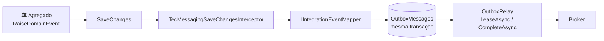

[🏠 TEC.Messaging](../README.md) › [📚 Documentação](README.md) › 🗄️ SQL Server

# 🗄️ SQL Server

> Persistência transacional do Outbox e do Inbox no SQL Server com EF Core: o evento é gravado junto com o agregado, a reserva de lotes não disputa linhas entre processos e a administração das mensagens com falha vem pronta.

## 📑 Sumário

- [🎯 Visão geral](#-visão-geral)
- [🚀 Uso](#-uso)
- [🗄️ Esquema e índices](#️-esquema-e-índices)
- [🔒 Concorrência e locks](#-concorrência-e-locks)
- [⚙️ Opções](#️-opções)
- [❌ Erros](#-erros)
- [🛡️ Segurança](#️-segurança)
- [❓ Perguntas frequentes](#-perguntas-frequentes)

---

## 🎯 Visão geral

O pacote `TEC.Messaging.SqlServer` implementa, sobre o `DbContext` da própria aplicação, as abstrações de armazenamento do núcleo:

| Peça | Implementa | Papel |
|---|---|---|
| `SqlServerOutboxStore<TContext>` | `IOutboxStore` · `IOutboxAdministration` | Reserva (lease), conclusão, limpeza, estatísticas, reprocessamento e descarte |
| `SqlServerOutbox<TContext>` | `IOutbox` | Grava um evento de integração sem agregado, na unidade de trabalho atual |
| `SqlServerInboxStore<TContext>` | `IInboxStore` | Registro de idempotência na mesma transação do efeito |
| `TecMessagingSaveChangesInterceptor` | `SaveChangesInterceptor` | Converte eventos de domínio dos agregados em linhas do Outbox no `SaveChanges` |
| `IDomainEventsSavingObserver` | — | Gancho opcional para gravar dados próprios na mesma transação |



| Recurso do SQL Server | Utilização |
|---|---|
| `TOP (@batchSize) ... WITH (UPDLOCK, READPAST, ROWLOCK)` + `OUTPUT inserted.*` | Reserva de lote em **um** `UPDATE`, sem esperar linhas travadas por outro relay |
| `SYSUTCDATETIME()` | Validade da reserva pelo relógio do banco, único para todas as instâncias |
| Índices filtrados (`Status = 0`, `1`, `2`) | Reserva, limpeza, estatísticas e listagem de falhas sem varrer as publicadas retidas |
| `SqlException` número `2627` | Reconhece a chave duplicada do Inbox (corrida entre entregas da mesma mensagem) |

O pacote não é compatível com Native AOT (`IsAotCompatible=false`): o EF Core usa modelo dinâmico e expressões compiladas. Segue o EF Core 8.x no `net8.0` e o 10.x no `net10.0`.

---

## 🚀 Uso

### 1. Registro dos serviços

```csharp
services.AddTecMessaging()
    .AddEventType<PedidoAprovadoV1>()
    .Map<PedidoAprovado>(e => new PedidoAprovadoV1(e.PedidoId, e.Total))
    .UseSqlServer<VendasDbContext>()
    .AddDomainEventsObserver<GravadorDeHistorico>()       // opcional
    .AddOutboxRelay()
    .AddInboxCleanup();                                   // se a aplicação consome mensagens

services.AddDbContext<VendasDbContext>((sp, o) => o.UseSqlServer(conexao).UseTecMessaging(sp));
```

`UseSqlServer<TContext>()` registra, com `TryAdd` (não sobrescreve registro próprio): `IOutboxStore`, `IOutboxAdministration`, `IOutbox` e `IInboxStore` como **scoped**, e o `TecMessagingSaveChangesInterceptor` como **singleton**. `AddDomainEventsObserver<T>()` registra o observador como singleton.

### 2. Modelo e migration

```csharp
public sealed class VendasDbContext(DbContextOptions<VendasDbContext> options) : DbContext(options)
{
    protected override void OnModelCreating(ModelBuilder modelBuilder)
    {
        base.OnModelCreating(modelBuilder);
        modelBuilder.AddTecMessaging("vendas");     // schema opcional; tabelas OutboxMessages e InboxMessages
    }
}
```

Depois gere a migration (`dotnet ef migrations add Mensageria`). A mesma chamada aceita nomes próprios: `AddTecMessaging(schema, outboxTable, inboxTable)`.

### 3. Quando o registro do contexto não expõe as opções

Se o contexto é registrado por outro componente (ex.: `AddTecOrm`), receba o interceptor pelo construtor e ligue-o no `OnConfiguring`:

```csharp
public sealed class VendasDbContext(DbContextOptions<VendasDbContext> options, TecMessagingSaveChangesInterceptor outbox) : DbContext(options)
{
    protected override void OnConfiguring(DbContextOptionsBuilder optionsBuilder) => optionsBuilder.AddInterceptors(outbox);

    protected override void OnModelCreating(ModelBuilder modelBuilder) => modelBuilder.AddTecMessaging("vendas");
}
```

### 4. Observador dos eventos de domínio

```csharp
internal sealed class GravadorDeHistorico : IDomainEventsSavingObserver
{
    public void OnSaving(DbContext context, IReadOnlyList<IDomainEvent> domainEvents)
    {
        foreach (var evento in domainEvents)
            context.Set<Historico>().Add(new Historico(evento));     // gravado na mesma transação
    }
}
```

O observador roda **dentro** do `SaveChanges`: mantenha-o rápido e síncrono. O que ele adicionar ao contexto também é desfeito se o `SaveChanges` falhar.

### 5. Evento sem agregado e Inbox

```csharp
outbox.Enqueue(new ParametrosAlteradosV1(chave));       // IOutbox: gravado no próximo SaveChanges
await db.SaveChangesAsync(ct);

if (!await inbox.TryBeginAsync(message.Envelope.MessageId, "faturamento", ct))
    return ConsumeResult.Completed;                      // já processada
db.Faturas.Add(fatura);
try { await db.SaveChangesAsync(ct); }
catch (DbUpdateException ex) when (inbox.IsDuplicate(ex)) { return ConsumeResult.Completed; }
```

Mais sobre os dois fluxos em [📤 Outbox](outbox.md) e [📥 Inbox](inbox.md).

---

## 🗄️ Esquema e índices

`AddTecMessaging` mapeia duas entidades (`TEC.Messaging.SqlServer.Entities`).

**`OutboxMessages`** (chave `Id`, sem geração: é o `MessageId`, UUIDv7):

| Coluna | Tipo | Observação |
|---|---|---|
| `Id` | `uniqueidentifier` | Chave primária |
| `Type` | `varchar(200)` | Contrato (`MessageEnvelope.MaxTypeLength`) |
| `Version` | `int` | Versão do contrato |
| `OccurredAt` | `datetimeoffset` | Quando o fato ocorreu |
| `CorrelationId` · `CausationId` · `TraceParent` | `varchar(128)` | Anuláveis (`MaxIdLength` e `MaxTraceParentLength`) |
| `Payload` | `nvarchar(max)` | JSON do evento |
| `Status` | `tinyint` | `0` Pending · `1` Published · `2` Dead |
| `Attempts` | `int` | Falhas de publicação |
| `NextAttemptAt` | `datetimeoffset` | Quando pode ser publicada |
| `LeaseToken` · `LeasedUntil` | `uniqueidentifier?` · `datetimeoffset?` | Reserva vigente |
| `PublishedAt` | `datetimeoffset?` | Quando foi publicada |
| `LastError` | `nvarchar(1000)` | Último erro, já sanitizado ([🛡️ Segurança](seguranca.md)) |

**`InboxMessages`**: chave composta `(MessageId, Consumer)`, `Consumer` `varchar(100)`, `ProcessedAt` e um índice em `ProcessedAt` (limpeza).

| Índice (`<tabela>` = nome da tabela do Outbox) | Chave | Filtro | Para quê |
|---|---|---|---|
| `IX_<tabela>_Pending` | `OccurredAt, Id` (inclui `NextAttemptAt`, `LeasedUntil`, `Attempts`) | `Status = 0` | Reserva na ordem de ocorrência e contagem das pendentes com erro |
| `IX_<tabela>_Published` | `PublishedAt` | `Status = 1` | Limpeza das publicadas vencidas |
| `IX_<tabela>_Dead` | `OccurredAt` | `Status = 2` | Contagem e listagem das mortas |

> [!IMPORTANT]
> Não troque a ordem das colunas de `IX_<tabela>_Pending`: ela segue a ordem da reserva. Com outra ordem o SQL Server leria e ordenaria todas as pendentes, travando-as de passagem, e reservas simultâneas pulariam (`READPAST`) mensagens que nenhuma delas pegaria.

> [!NOTE]
> Os filtros dos índices usam o **nome real** da coluna `Status` (convenções como `snake_case` já aplicadas). Renomear a coluna depois de `AddTecMessaging` não atualiza os filtros.

---

## 🔒 Concorrência e locks

A reserva é um único `UPDATE` sobre uma CTE:

```sql
WITH batch AS (
    SELECT TOP (@batchSize) * FROM [vendas].[OutboxMessages] WITH (UPDLOCK, READPAST, ROWLOCK)
    WHERE [Status] = 0 AND [NextAttemptAt] <= @now
        AND ([LeasedUntil] IS NULL OR [LeasedUntil] < TODATETIMEOFFSET(SYSUTCDATETIME(), 0))
    ORDER BY [OccurredAt], [Id])
UPDATE batch SET [LeaseToken] = @token, [LeasedUntil] = DATEADD(millisecond, @leaseMs, TODATETIMEOFFSET(SYSUTCDATETIME(), 0))
OUTPUT inserted.*;
```

| Garantia | Como |
|---|---|
| Dois relays não reservam a mesma mensagem | `UPDLOCK` + `READPAST`: cada um trava só as linhas que reserva e pula as travadas pelo outro |
| A reserva sobrevive à transação | `LeaseToken` e `LeasedUntil` ficam gravados; a publicação acontece **fora** de qualquer transação |
| Relógios divergentes não duplicam | A validade (`LeasedUntil`) é gravada e comparada pelo relógio do banco (`SYSUTCDATETIME`). Só `NextAttemptAt` usa o relógio da aplicação |
| Conclusão só por quem reservou | `CompleteAsync` atualiza com `WHERE LeaseToken = @token`; se outra reserva assumiu a mensagem, a conclusão é ignorada |
| Administração não desfaz reserva ativa | `RequeueAsync` ignora pendentes com `LeasedUntil` ainda válido (relógio do banco) |

O `CompleteAsync` agrupa as publicadas por token e aplica um `ExecuteUpdate` por grupo; `Failed`, `Dead` e `Released` são atualizados um a um. `Released` só devolve a mensagem (nova `NextAttemptAt`, reserva limpa) e **não** altera `Attempts`.

---

## ⚙️ Opções

O pacote não tem classe de opções própria: as opções do relay estão em [📤 Outbox](outbox.md#️-opções) e as da limpeza do Inbox em [📥 Inbox](inbox.md#️-opções). O que se configura aqui é o mapeamento:

| Parâmetro de `AddTecMessaging` | Padrão | Descrição |
|---|---|---|
| `schema` | `null` | Esquema das duas tabelas (`null` = o padrão do modelo) |
| `outboxTable` | `OutboxMessages` | Nome da tabela do Outbox (também compõe o nome dos índices) |
| `inboxTable` | `InboxMessages` | Nome da tabela do Inbox |

Limites das operações do store:

| Operação | Limite |
|---|---|
| `LeaseAsync` | `batchSize` de 1 a 1000; `leaseDuration` até 1 dia |
| `ListFailedAsync` | `limit` de 1 a 1000 |
| `RequeueAsync` · `DiscardAsync` | 1 a 1000 ids (`RequeueAsync` aceita `null` = todas; coleção vazia é recusada) |
| `PurgePublishedAsync` · `PurgeAsync` | `maxRows` ≥ 1 (o relay usa lotes de 5.000) |
| `TryBeginAsync` | Nome do consumidor com até 100 caracteres |

---

## ❌ Erros

| Situação | Causa | O que fazer |
|---|---|---|
| `InvalidOperationException: OutboxMessage não está no modelo de ...` (ou `InboxMessage`) | Faltou `modelBuilder.AddTecMessaging()` | Chame no `OnModelCreating` e gere a migration |
| `InvalidOperationException: Registre o armazenamento com services.AddTecMessaging().UseSqlServer<TContext>().` | `UseTecMessaging(sp)` sem o `UseSqlServer<TContext>()` | Registre o armazenamento antes |
| `SqlException` 208 (objeto inválido) | Migration da mensageria não aplicada | Gere e aplique a migration |
| `ArgumentOutOfRangeException` em `RequeueAsync`/`DiscardAsync` | Coleção vazia ou com mais de 1000 ids | Envie de 1 a 1000 ids (ou `null` em `RequeueAsync` para todas) |
| `ArgumentOutOfRangeException` em `TryBeginAsync` | Nome do consumidor com mais de 100 caracteres | Use um nome curto e estável |
| `DbUpdateException` com `SqlException` 2627 | Duas entregas simultâneas da mesma mensagem | `inbox.IsDuplicate(ex)` reconhece só a chave do Inbox; devolva `Completed` |
| Pendentes sem sair | Relay parado, reserva vigente ou broker fora | Veja o gauge `tec.messaging.outbox.oldest_pending_age` e os logs 4001–4006 |

---

## 🛡️ Segurança

> [!WARNING]
> O relay publica o que está na tabela: quem escreve em `OutboxMessages` publica no broker. Conceda escrita só ao login da aplicação.

- O SQL escrito à mão usa nomes de tabela e coluna **vindos do modelo** e delimitados (`]` escapado); valores sempre por parâmetro.
- `LastError` é sanitizado ([`SensitiveDataSanitizer`](seguranca.md)) e truncado em 1000 caracteres antes de ser gravado.
- A conexão do banco é da aplicação (resolva-a no cofre, por exemplo com o [TEC.Vault](https://github.com/tudoemcodigo/lib-tec-vault)); o pacote não guarda credenciais.

## ❓ Perguntas frequentes

<details>
<summary><b>Os eventos somem do agregado se o SaveChanges falhar?</b></summary>

Não. O interceptor só limpa os eventos depois de um `SaveChanges` bem-sucedido; na falha, retira do rastreamento as mensagens (e o que os observadores adicionaram) e a nova tentativa gera tudo de novo, sem duplicar. Detalhes e o caso da transação externa em [📤 Outbox](outbox.md#-perguntas-frequentes).
</details>

<details>
<summary><b>Posso usar o Outbox e o Inbox em contextos diferentes?</b></summary>

Cada `UseSqlServer<TContext>()` liga um contexto. O `IInboxStore` precisa estar no **mesmo** `DbContext` (mesmo escopo) do efeito do consumidor, senão o registro e o efeito não saem na mesma transação.
</details>

<details>
<summary><b>E se a aplicação usar PostgreSQL?</b></summary>

Use o [🐘 PostgreSQL](postgresql.md): mesmo contrato, com `FOR UPDATE SKIP LOCKED` e `RETURNING`.
</details>

---
⬅️ [📥 Inbox](inbox.md) · [📚 Índice](README.md) · [🐘 PostgreSQL](postgresql.md) ➡️
