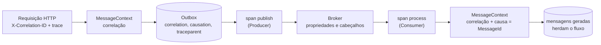

[🏠 TEC.Messaging](../README.md) › [📚 Documentação](README.md) › 📡 Telemetria

# 📡 Telemetria

> Spans, métricas e correlação de ponta a ponta, do caso de uso ao consumidor.

## 📑 Sumário

- [🎯 Visão geral](#-visão-geral)
- [🚀 Uso](#-uso)
- [📘 Referência](#-referência)
- [⚙️ Opções](#️-opções)
- [❌ Erros](#-erros)
- [🛡️ Segurança](#️-segurança)
- [❓ Perguntas frequentes](#-perguntas-frequentes)

---

## 🎯 Visão geral



Os sinais saem do núcleo (`MessagingDiagnostics`) e usam só a BCL (`ActivitySource` e `Meter` com o nome `TEC.Messaging`); os satélites de broker iniciam os spans. Nenhum sinal carrega o payload.

| Sinal | Nome | Detalhe |
|---|---|---|
| Span | `<tipo> publish` (Producer) | `messaging.system`, `messaging.destination.name`, `messaging.message.id`, `messaging.message.conversation_id` |
| Span | `<tipo> process` (Consumer) | Continua o trace do produtor pelo `traceparent` |
| Contador | `tec.messaging.outbox.enqueued` / `published` / `publish_failures` / `dead` | Tag `tec.messaging.type` |
| Contador + histograma | `tec.messaging.consumer.messages` / `tec.messaging.consumer.duration` | Tags `messaging.destination.name`, `tec.messaging.outcome` |
| Gauge | `tec.messaging.outbox.pending` / `pending_with_errors` / `dead_messages` / `oldest_pending_age` | Atualizados pelo relay. São contagens **globais** do banco emitidas por todas as instâncias: agregue com `max`, não `sum` |
| Gauge | `tec.messaging.dlq.messages` | Por fila, pelo monitor do RabbitMQ |
| Contador | `tec.messaging.connection.circuit.state_changes` | Tags `messaging.system` (`rabbitmq`), `tec.messaging.circuit.state` (`open`, `half_open`, `closed`) |

ActivitySource e Meter: `TEC.Messaging` (`MessagingDiagnostics.ActivitySourceName`/`MeterName`), assinados automaticamente pelo
TEC.Observability.

---

## 🚀 Uso

### Com o TEC.Observability

Nada a fazer: o `AddTecObservability` exporta as fontes `TEC.*` (inclusive `TEC.Messaging`).

### OpenTelemetry direto

```csharp
using TEC.Messaging.Diagnostics;

builder.Services.AddOpenTelemetry()
    .WithTracing(tracing => tracing.AddSource(MessagingDiagnostics.ActivitySourceName))   // "TEC.Messaging"
    .WithMetrics(metrics => metrics.AddMeter(MessagingDiagnostics.MeterName));            // "TEC.Messaging"
```

### Correlação na borda HTTP

```csharp
app.Use(async (http, next) =>
{
    using var _ = MessageContext.Begin(http.Request.Headers["X-Correlation-ID"]);
    await next(http);
});
```

O consumidor abre o escopo sozinho (correlação do envelope e causa = `MessageId` recebido): mensagens gravadas no Outbox
durante o processamento herdam os dois. `MessageContext.Begin(correlationId, causationId)` devolve um `IDisposable`; o escopo anterior volta no `Dispose`.

### Alertas sugeridos

| Alerta | Sinal |
|---|---|
| Outbox parado ou broker fora | `oldest_pending_age > 300 s` |
| Mensagens que precisam de ação humana | `dead_messages > 0` |
| Mensagens na DLQ do RabbitMQ | `dlq.messages > 0` |
| Broker inalcançável | `connection.circuit.state_changes{tec.messaging.circuit.state="open"}` (logs 4401–4404, e 4211 por fila enquanto espera) |
| Falhas de publicação em alta | taxa de `outbox.publish_failures` |

---

## 📘 Referência

### Traces

| Span | Tipo | Nome | Quando |
|---|---|---|---|
| Publicação | `Producer` | `<Type do contrato> publish` | Cada `PublishAsync` (RabbitMQ, Azure Service Bus e AWS). O pai é o `traceparent` gravado no Outbox (o trace da requisição que gerou o evento) |
| Consumo | `Consumer` | `<Type> process`, ou `<destino> process` | Cada mensagem recebida. Se o `Type` não tem o formato de nome de contrato (entrada não confiável), o span leva o nome do destino, para um produtor não inflar a cardinalidade |

Tags: `messaging.system` (`rabbitmq`, `azure-servicebus`, `aws` na publicação e `aws-sqs` no consumo), `messaging.operation.type` (`publish`/`process`), `messaging.destination.name` (exchange, fila, tópico, URL ou ARN), `messaging.message.id`, `messaging.message.conversation_id` (a correlação) e `tec.messaging.type`. O publicador do RabbitMQ acrescenta `messaging.rabbitmq.destination.routing_key`. O consumidor do RabbitMQ marca o span com erro quando o desfecho não é `Completed`.

O publicador grava no `traceparent` da mensagem o id do próprio span de publicação: o consumidor continua o trace a partir dele.

### Métricas

| Instrumento | Tipo | Unidade | Tags | Descrição |
|---|---|---|---|---|
| `tec.messaging.outbox.enqueued` | Contador | `{message}` | `tec.messaging.type` | Gravadas no Outbox (contadas só depois do `SaveChanges` bem-sucedido, inclusive via `IOutbox`) |
| `tec.messaging.outbox.published` | Contador | `{message}` | `tec.messaging.type` | Publicadas com confirmação do broker |
| `tec.messaging.outbox.publish_failures` | Contador | `{message}` | `tec.messaging.type` | Falhas de publicação (cada tentativa, inclusive de transporte indisponível) |
| `tec.messaging.outbox.dead` | Contador | `{message}` | `tec.messaging.type` | Esgotaram as tentativas |
| `tec.messaging.consumer.messages` | Contador | `{message}` | `messaging.destination.name`, `tec.messaging.outcome` (`completed`, `retried`, `rejected`, `requeued`) | Mensagens consumidas, por desfecho |
| `tec.messaging.consumer.duration` | Histograma | `s` | as mesmas | Duração do processamento de uma mensagem |
| `tec.messaging.connection.circuit.state_changes` | Contador | `{change}` | `messaging.system`, `tec.messaging.circuit.state` | Mudanças de estado do circuit breaker da conexão |
| `tec.messaging.outbox.pending` | Gauge | `{message}` | — | Pendentes no Outbox |
| `tec.messaging.outbox.pending_with_errors` | Gauge | `{message}` | — | Pendentes que já falharam |
| `tec.messaging.outbox.dead_messages` | Gauge | `{message}` | — | Mortas aguardando o administrador |
| `tec.messaging.outbox.oldest_pending_age` | Gauge | `s` | — | Idade da pendente mais antiga |
| `tec.messaging.dlq.messages` | Gauge | `{message}` | `messaging.destination.name` | Mensagens nas DLQs, por fila |

> [!NOTE]
> Hoje só o consumidor do RabbitMQ emite `consumer.messages` e `consumer.duration`; o monitor de DLQ e o circuit breaker de conexão também são do RabbitMQ. Os consumidores do Azure Service Bus e da AWS emitem apenas os spans de consumo.

### Logs

Os eventos usam `LoggerMessage` com ids estáveis: relay do Outbox 4001–4006, limpeza do Inbox 4101–4102, consumidor do RabbitMQ 4201–4214, monitor de DLQ 4301 e conexão do RabbitMQ 4401–4404. A lista completa por componente está em [📤 Outbox](outbox.md#-erros) e [🐇 RabbitMQ](rabbitmq.md#-erros). O erro gravado em `LastError`, o resumo de transporte indisponível do relay e o cabeçalho `x-tec-error` passam pelo `SensitiveDataSanitizer`; o objeto de exceção entregue ao `ILogger` (ex.: evento 4204) não ([🛡️ Segurança](seguranca.md)).

---

## ⚙️ Opções

| Opção | Efeito nos sinais |
|---|---|
| `OutboxOptions.StatisticsInterval` (30 s) | Atualização dos gauges do Outbox (0 desliga) |
| `RabbitMqOptions.DeadLetterMonitorInterval` (1 min) | Atualização do gauge `dlq.messages` (0 desliga) |

## ❌ Erros

| Situação | Causa | O que fazer |
|---|---|---|
| Gauges do Outbox sem valor | Sem `IOutboxAdministration` registrado ou intervalo 0 | Use `UseSqlServer<TContext>()` ou `UsePostgreSql<TContext>()`; ajuste o intervalo |
| Gauges do Outbox sem valor com o relay desligado | Os gauges são atualizados pelo `OutboxRelay` | Ligue `AddOutboxRelay()` na instância que deve emiti-los |
| Sem métricas de consumo no Azure/AWS | Só o RabbitMQ emite essas métricas | Use os spans de consumo e as métricas do broker |
| Consumidor sem trace do produtor | Mensagem sem `traceparent` (produtor externo) | O span de consumo começa um trace novo |

## 🛡️ Segurança

> [!NOTE]
> Spans e métricas nunca carregam o payload; só tipo, id e correlação. A correlação de entrada é sanitizada (tamanho e
> caracteres de controle). O `Type` vindo do broker só vira nome de span se tiver o formato de nome de contrato.

## ❓ Perguntas frequentes

<details>
<summary><b>Sem escopo aberto, qual correlação vai para a mensagem?</b></summary>

O `TraceId` da atividade atual (W3C), se houver.
</details>

<details>
<summary><b>Quais valores de correlação são aceitos?</b></summary>

Até 128 caracteres, sem caracteres de controle e não vazios. Valores inválidos são ignorados (a correlação cai para o `TraceId`).
</details>

<details>
<summary><b>Por que somar os gauges do Outbox dá um número errado?</b></summary>

São contagens globais do banco, emitidas por todas as instâncias do relay. Agregue com `max`.
</details>

---
⬅️ [🟧 AWS SQS / SNS](aws.md) · [📚 Índice](README.md) · [🛡️ Segurança](seguranca.md) ➡️
